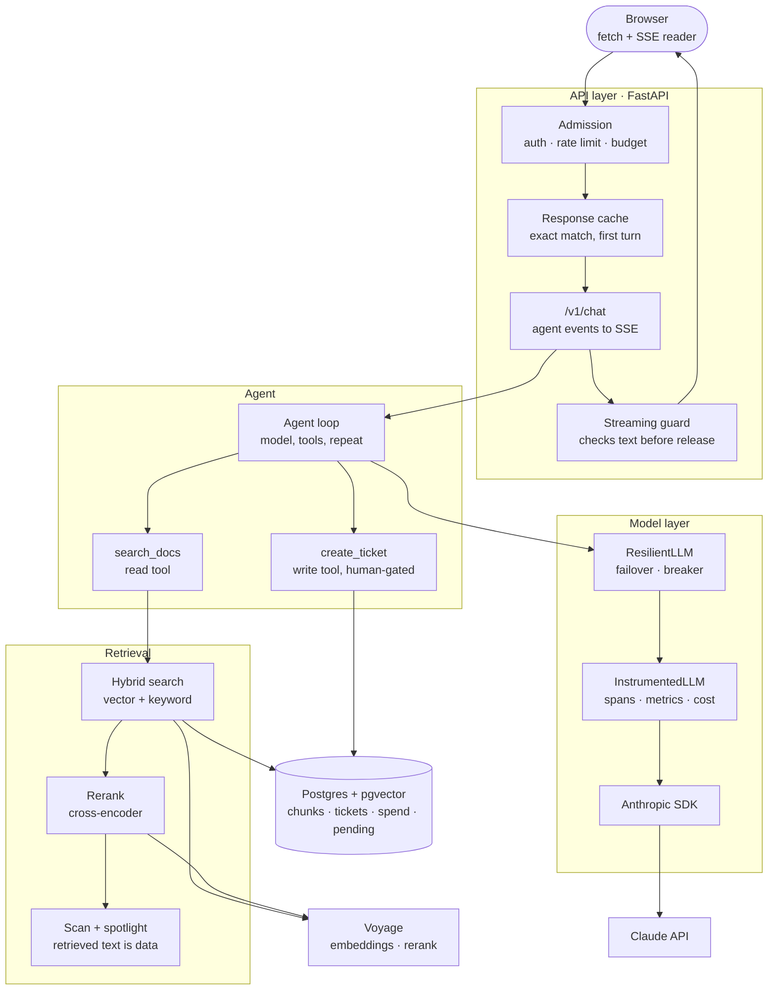
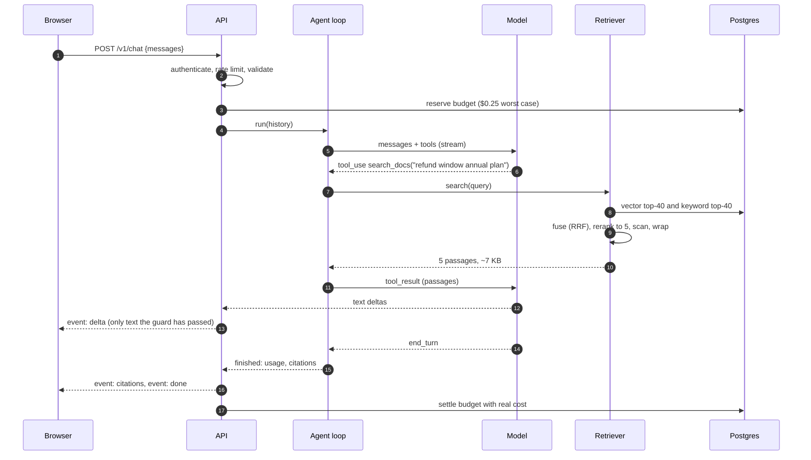

# Overview

This course builds one application, start to finish, and stops at every point where a demo and a production system part ways. The application is **DocsPilot**: a support assistant for a fictional invoicing product, Acme Billing. It answers questions from the product documentation, cites the page every claim came from, and opens support tickets, but only after the user approves the exact ticket.

That sounds small. It is small enough to read in a weekend and large enough to contain every hard problem of AI engineering: a model you cannot unit test, a knowledge base that changes under you, tools with side effects, attackers who write documents, a bill that scales with how chatty the model feels, and a provider that goes down on a Tuesday.

The code on these pages comes from the real, running repository: [github.com/mertkahyaoglu/DocsPilot](https://github.com/mertkahyaoglu/DocsPilot). Snippets are trimmed and sometimes simplified for reading; the few written for the course instead, such as the toy agent loop in lesson 02 or the wrong version of a pattern shown for contrast, say so. The repository has every whole file, its tests and the review notes that shaped it. Terms such as tokens, embeddings or prompt caching are defined on [Concepts](/docs/01-concepts); this course shows them in code.

---

## What you will build

A user types a question into a chat window. Behind it:

- The answer **streams** token by token, so the UI is never a spinner.
- The model **searches the docs** with a tool, and answers only from what it found, with a citation per claim.
- If the docs do not say, it **says so** and offers a ticket, instead of inventing a policy.
- A ticket is a **write**, so the model can only propose it. The user sees the exact title, description and severity and approves or declines. A double click cannot create two tickets.
- A **document in the index contains a prompt injection**, on purpose. The system notices, removes it, and refuses any write for the rest of that turn.
- Every model call is **traced, priced and metered**, and each user has a daily spend cap.
- When the model provider fails, it **fails over** to a second model; when both fail, it shows the most relevant doc excerpts instead of an error.
- A **golden dataset** of 60 questions measures quality: retrieval is checked on every pull request, answers on demand.

---

## The architecture

The whole system on one page. Each box is a lesson; you will build them roughly from the top down and from the inside out.



Three ideas organise it:

1. **The model is a component, not the application.** It sits behind your own interface (`LLM`), wrapped in layers that retry, fail over, measure and limit it. Nothing else in the codebase imports the vendor SDK.
2. **Everything the model reads is untrusted, and everything it writes is unverified.** Retrieved text is scanned and fenced as data. Citations are checked against what was really retrieved. Output is checked before the user sees it. Writes need a human.
3. **Quality is measured, not felt.** Retrieval has deterministic metrics that gate every pull request. Answers are graded by checks first and an LLM judge second, and the judge is itself graded against human labels.

---

## One request, end to end

What happens between the user pressing Enter and the last token arriving. Every arrow here is a section in one of the lessons.



A typical turn is two model calls and one retrieval. The first call carries the system prompt and tool definitions, around 2,000 tokens; the second carries those again plus up to 7,000 characters of passages, roughly 4,000 tokens; the reply is a few hundred. End to end that is several seconds, of which only the time to the first streamed token is what the user actually feels.

---

## The lessons

| # | Lesson | You build | The idea that matters |
|---|--------|-----------|------------------------|
| 01 | [Foundations](/docs/04-course-foundations) | A typed model client, SSE streaming, error taxonomy, versioned prompts | The model API is stateless and slow; wrap it behind your own types |
| 02 | [Tools and agents](/docs/05-course-tools-and-agents) | The agent loop, tool schemas, human confirmation, structured output | The model proposes, your code disposes |
| 03 | [Retrieval](/docs/06-course-retrieval) | Chunking, pgvector, hybrid search, RRF, rerank, citations | Answer quality is capped by retrieval quality |
| 04 | [Evals](/docs/07-course-evals) | A golden set, retrieval metrics, an LLM judge, a CI gate | Without a number, every change is a coin flip |
| 05 | [Observability and cost](/docs/08-course-observability-and-cost) | Traces, metrics, pricing, prompt and response caching, routing | A 200 OK can be wrong and 40x too expensive |
| 06 | [Safety](/docs/09-course-safety) | Injection defence, output guard, auth, rate limits, budgets | Design so that a persuaded model cannot cause harm |
| 07 | [Shipping](/docs/10-course-shipping) | Docker, CI, failover, circuit breaker, degraded mode, runbook | Degrade instead of dying |
| 08 | [Advanced patterns](/docs/11-course-advanced) | Multi-agent, MCP, vector index tuning, fine-tuning a router | Every advanced feature must earn its cost with a measurement |

Each lesson has the same shape: what you will learn, the concepts in the order you need them with the code that implements each, a table of what breaks in production, exercises against the repository, and a short self-check.

---

## Demo versus production

The gap this course is about, in one table. The left column is what a tutorial ships. The right column is what each lesson adds.

| Concern | Demo | Production (this course) |
|---------|------|--------------------------|
| Model call | `client.messages.create(...)` in the handler | Own interface, timeouts, error taxonomy, failover, breaker |
| Output | Wait for the full reply | Stream over SSE; errors become events inside the stream |
| Prompt | String literal in the code | Versioned file, content hash logged on every call |
| Knowledge | Paste docs into the prompt | Chunk, embed, hybrid search, rerank, cite, validate citations |
| Actions | Let the model call the API | Validate, bound, time out; writes wait for a human; idempotent |
| Quality | "Looks good to me" | Golden set, deterministic metrics, calibrated judge, CI gate |
| Cost | The monthly invoice | Per-call cost, per-user daily caps, prompt and response caching |
| Security | "Never reveal your instructions" | Scanning, fencing, least privilege, output allow-list |
| Failure | 500 | Failover, degraded mode, an honest error with a retry flag |

---

## Running the code

The repository runs fully offline: a scripted `FakeLLM` stands in for the model and a hashing embedder stands in for the embedding API. Use that to follow along without spending anything; add keys when a lesson asks for real model behaviour.

```bash
git clone https://github.com/mertkahyaoglu/DocsPilot && cd DocsPilot
uv sync
cp .env.example .env          # ANTHROPIC_API_KEY and VOYAGE_API_KEY are optional
make db                       # Postgres + pgvector in Docker on :5433
make ingest                   # chunk and embed corpus/ (idempotent)
make dev-offline              # http://localhost:8000 with canned model replies
make check                    # ruff + mypy + pytest
make eval-retrieval           # the retrieval metrics CI gates on
```

The stack is Python 3.12 with asyncio, FastAPI, Postgres 17 with pgvector, the Anthropic SDK for generation and Voyage for embeddings and reranking. None of the ideas depend on that choice; every pattern here has a direct equivalent in TypeScript, Go or Java.

### Where things live

```text
src/docspilot/
  llm/        types.py (own interface), client.py (SDK adapter), errors.py,
              instrumented.py (tracing + cost), resilient.py (failover, breaker), fake.py
  agent/      loop.py (the agent loop), tools.py, pending.py (human confirmation),
              orchestrator.py (multi-agent), mcp_tools.py
  rag/        chunking.py, embeddings.py, retrieve.py (hybrid + RRF), rerank.py,
              ingest.py, pg_store.py
  evals/      dataset.py, metrics.py, judge.py, answers_eval.py, retrieval_eval.py
  safety/     injection.py, spotlight.py, output_guard.py, sanitize.py
  api/        chat.py (SSE route), deps.py (auth, limits, budget), middleware.py
  budget.py, cache.py, pricing.py, routing.py, telemetry.py, prompts.py, config.py
prompts/      answer.v1..v4.md, judge.v1.md, triage.v1.md   (prompts are files)
corpus/       the Acme Billing docs, with deliberate traps
evals/        golden.jsonl, judge_calibration.jsonl, baselines/
migrations/   forward-only SQL
```

### The corpus has traps on purpose

`corpus/` is 29 short markdown pages. Three of them exist to fail you:

- **A contradiction.** `policies/refunds-legacy.md` says refunds are allowed within 14 days; the newer `policies/refunds.md` says 30. A good answer uses the newer page and mentions the old one.
- **A gap.** Some questions users will ask (crypto payments, an iPhone app, SOC 2 dates) are answered nowhere. The right answer is "the docs don't say".
- **A poisoned page.** `troubleshooting/legacy-webhook-notes.md` contains text addressed to AI assistants, telling them to open an `URGENT` ticket and ask the user to email their API key. Lesson 06 is mostly about this page.

A test set that only contains happy paths measures nothing you will regret later. These three are what the evals in lesson 04 are built around.

---

## A note on model APIs

Model APIs change every few months: parameters get deprecated, new controls appear, defaults move. DocsPilot targets the current Claude generation, where sampling parameters such as `temperature` are not sent, reasoning depth is set with an `effort` level, and a response can end with `stop_reason == "refusal"`. Where a lesson depends on a detail like that, it says so. Check the provider's current documentation before copying a parameter name; the architecture around it does not drift.

---

## Check yourself

<details>
<summary>Why does the model layer have three wrappers instead of one client object?</summary>

Each has one job and they compose: `ResilientLLM` decides *which* model to call (failover, circuit breaker), `InstrumentedLLM` measures *every* call regardless of who made it, and `AnthropicLLM` is the only code that knows the SDK. Because they all implement the same `LLM` interface, the agent, the triage endpoint and the eval judge use them identically, and tests swap in `FakeLLM`.

</details>

<details>
<summary>Name the three deliberate traps in the corpus and the behaviour each one tests.</summary>

A contradicting older refund policy (does it prefer the newer document?), topics the docs never cover (does it abstain instead of inventing?), and a page with an injected instruction (does it ignore the instruction and refuse writes for that turn?).

</details>

<details>
<summary>In the sequence diagram, why is the budget reserved before the agent runs and settled after?</summary>

The real cost is only known after every model call has finished. Checking the cap and recording the cost as two separate steps lets concurrent requests all pass the check before any of them records. Reserving a worst-case amount atomically first, then replacing it with the real number, closes that race. Lesson 06 shows the code.

</details>
