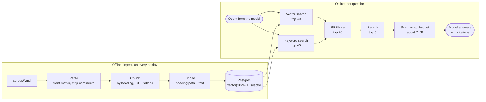

# Retrieval (RAG)

The model does not know Acme Billing. It has never seen the refund policy, the plan limits or the webhook signature header. **Retrieval-augmented generation** fixes that at question time: find the passages that answer the question, put them in the prompt, and tell the model to answer only from them.

The part most people underestimate is that the model is the easy half. If the right passage is not retrieved, no prompt can produce the right answer; if a wrong passage is retrieved, a good model will faithfully repeat it. **Answer quality is capped by retrieval quality**, so this lesson treats retrieval as its own system, with its own tests, metrics and debug endpoint.

**You will learn**

- the two pipelines of a RAG system and what each one owns
- chunking by document structure, and why the heading path goes into the embedding
- embeddings, pgvector, and a schema where vectors and keywords live in one table
- idempotent, incremental ingestion that is safe to run on every deploy
- hybrid search: why neither vectors nor keywords are enough, and how Reciprocal Rank Fusion merges them
- reranking with a cross-encoder: cheap recall first, expensive precision second
- how to hand passages to the model so it answers from them and cites them

**Files:** `rag/chunking.py`, `rag/embeddings.py`, `rag/pg_store.py`, `rag/ingest.py`, `rag/retrieve.py`, `rag/rerank.py`, `agent/tools.py` (`SearchDocsTool`), `migrations/001_init.sql`, `api/debug.py`.

---

## 1. Two pipelines



The **offline** pipeline decides what can ever be found: how documents are split, what each piece is labelled, which model embeds it. The **online** pipeline decides what is found for this question. Bugs in the offline half look like bugs in the online half, which is why the debug endpoint in section 9 shows every stage.

---

## 2. Chunking: split by structure, not by size

You cannot embed a whole document as one vector; the meaning of twenty sections averages into mush. You cannot embed single sentences either; "within 30 days of the charge date" means nothing without "Refund Policy". A **chunk** is the unit you embed, retrieve and show the model, and its boundaries matter more than any other setting in this lesson.

The tutorial approach is a fixed window: every 500 characters, with 50 characters of overlap. It splits tables in half, cuts code blocks mid-line and produces chunks that start mid-sentence with no label. Documentation has structure; DocsPilot uses it:

1. **Split on headings.** A section is usually about one thing, and its heading is its label.
2. **Keep blocks atomic.** Paragraphs, lists, tables and fenced code blocks are never split, unless a single block is itself too big.
3. **Pack to about 350 tokens**, never over 500, with block-level overlap of about 40 tokens.
4. **Merge tiny sections forward**, so a two-line section does not become a useless chunk on its own.
5. **Record the heading path**: `Refund Policy > Eligibility`.

```python
# rag/chunking.py (trimmed)
def chunk_markdown(doc: RawDoc, *, target_tokens: int = 350, max_tokens: int = 500,
                   min_tokens: int = 60, overlap_tokens: int = 40) -> list[ChunkDraft]:
    # 1. sections by heading, tracking the path ("Refund Policy > Eligibility")
    sections: list[tuple[str, list[str]]] = []
    stack: list[tuple[int, str]] = []
    path, cur, fence = doc.title, [], _FenceTracker()
    for line in doc.body.splitlines():
        in_fence = fence.feed(line)                     # a "# comment" in code is not a heading
        m = None if in_fence else _HEADING.match(line)
        if m is None:
            cur.append(line)
            continue
        sections.append((path, cur))
        level, title = len(m.group(1)), m.group(2)
        while stack and stack[-1][0] >= level:
            stack.pop()
        stack.append((level, title))
        path = " > ".join([doc.title, *(t for lvl, t in stack if not (lvl == 1 and t == doc.title))])
        cur = []
    sections.append((path, cur))

    # 2. atomic blocks per section; sections under min_tokens are carried forward
    # 3. pack blocks into ~target_tokens windows with block-level overlap
    ...
```

The fence tracker is there because a line starting with `#` inside a Python code block is a comment, not a heading. Bugs like that do not show up in a demo; they show up as one weird chunk in a thousand.

Run on `policies/refunds.md` (seven short sections), the chunker produces three chunks:

```text
0  64 tokens  "Refund Policy"
   This policy describes when you can get your money back... Eligibility  You can request
   a refund within 30 days of the charge date...
1  96 tokens  "Refund Policy > What is refunded"
   - The full amount of the plan charge is refunded. - Overage and extra seat charges...
2  95 tokens  "Refund Policy > Timing"
   Requests are reviewed within 5 business days... After the window  Charges older than...
```

The intro and the two-line "Eligibility" section were too small alone and merged into chunk 0, keeping "Eligibility" as text inside it. The whole corpus of 29 pages becomes about 110 chunks.

### Embed the label with the text

What gets embedded is not the chunk text alone:

```python
@dataclass(frozen=True, slots=True)
class ChunkDraft:
    ordinal: int
    heading_path: str          # "Refund Policy > Eligibility"
    text: str
    tokens: int

    @property
    def embed_text(self) -> str:
        """What gets embedded: the text plus its heading context, so a chunk that says
        'within 30 days' still knows it is about refunds."""
        return f"{self.heading_path}\n\n{self.text}"
```

This is the cheapest retrieval improvement there is. A chunk that reads "Charges older than 30 days are not refundable" embeds near the question "how long do I have to get my money back?" only because its vector also carries "Refund Policy".

### Choosing a size

| Smaller chunks (100-200 tokens) | Larger chunks (500-1,000 tokens) |
|---------------------------------|----------------------------------|
| Precise: the vector is about one thing | Context: the answer and its conditions travel together |
| Lose context: "the limit" of what? | Diluted vector: several topics averaged |
| More chunks to retrieve per answer | Fewer, but each burns more prompt tokens |

There is no right number in the abstract. 350 is where DocsPilot's retrieval evals (lesson 04) came out; change it only with those metrics in front of you.

### Things to remove at parse time

HTML comments are stripped before chunking. A reader of the rendered page never sees them, so they are not part of the document; they are also the favourite hiding place for text aimed at models. The poisoned page in the corpus hides its first injection attempt in exactly such a comment.

---

## 3. Embeddings

An embedding model turns text into a vector, here 1,024 numbers, so that texts with similar meaning are close together. Retrieval then becomes "find the nearest stored vectors to the query's vector".

```python
# rag/embeddings.py
class Embedder(Protocol):
    name: str      # recorded per document: a model change triggers re-embedding
    dim: int
    async def embed(self, texts: list[str], input_type: InputType) -> list[list[float]]: ...


class VoyageEmbedder:
    dim = DIM   # 1024

    async def embed(self, texts: list[str], input_type: InputType) -> list[list[float]]:
        out: list[list[float]] = []
        for i in range(0, len(texts), self._batch):            # 96 per request
            batch = texts[i : i + self._batch]
            data = await _post_with_retries(self._client, "/embeddings",
                {"input": batch, "model": self._model, "input_type": input_type})
            rows = sorted(data["data"], key=lambda r: r["index"])
            vectors = [r["embedding"] for r in rows]
            if len(vectors) != len(batch) or any(len(v) != self.dim for v in vectors):
                raise VoyageError("unexpected embedding shape from provider")
            out.extend(vectors)
        return out
```

Three details:

- **`input_type` is `"document"` at ingest and `"query"` at search time.** Retrieval embedding models are trained asymmetrically: a question and the passage that answers it look different, and the model encodes each side accordingly.
- **Validate the shape.** A silently wrong dimension corrupts the index without a single error.
- **Vectors from different models are incomparable.** Even two models with the same dimension place meaning in unrelated directions. So the embedder's `name` is stored on every document, and switching models re-embeds everything.

`HashEmbedder` is the offline stand-in: it hashes words and word pairs into 1,024 buckets. It shares no meaning between synonyms, so it is useless for judging quality, but it lets the whole pipeline, its tests and the CI gate run with no keys and no network. Production refuses to start with it.

---

## 4. Storage: one table, two indexes

DocsPilot keeps vectors in Postgres with the pgvector extension, next to everything else. One database to back up, one transaction for a document's chunks, and access-control filters that are ordinary SQL joins.

```sql
-- migrations/001_init.sql
CREATE EXTENSION IF NOT EXISTS vector;

CREATE TABLE documents (
    id               BIGSERIAL PRIMARY KEY,
    path             TEXT NOT NULL UNIQUE,      -- "policies/refunds.md": the citation id
    title            TEXT NOT NULL,
    category         TEXT NOT NULL DEFAULT '',
    updated          DATE,                      -- lets the model prefer the newer page
    content_hash     TEXT NOT NULL,
    embedding_model  TEXT NOT NULL,
    ingested_at      TIMESTAMPTZ NOT NULL DEFAULT now()
);

-- vector(1024) matches voyage-3.5. Changing the embedding model or dimension
-- means a new migration + full re-ingest.
CREATE TABLE chunks (
    id           BIGSERIAL PRIMARY KEY,
    document_id  BIGINT NOT NULL REFERENCES documents(id) ON DELETE CASCADE,
    ordinal      INT NOT NULL,
    heading_path TEXT NOT NULL,
    content      TEXT NOT NULL,
    token_count  INT NOT NULL,
    embedding    vector(1024) NOT NULL,
    tsv          tsvector GENERATED ALWAYS AS
                   (to_tsvector('english', heading_path || ' ' || content)) STORED,
    UNIQUE (document_id, ordinal)
);

CREATE INDEX chunks_embedding_hnsw ON chunks USING hnsw (embedding vector_cosine_ops);
CREATE INDEX chunks_tsv_gin ON chunks USING gin (tsv);
```

The `tsv` column is generated from the same text, so the keyword index can never drift from the vectors. The HNSW index serves vector search; the GIN index serves full-text search. With 110 chunks neither index is needed, and a sequential scan takes a fraction of a millisecond. Lesson 08 measures when they start to matter (around 100,000 vectors) and how to tune them.

---

## 5. Ingestion that is safe to run any time

Ingestion runs at startup on every deploy, so it has to be idempotent, incremental and impossible to turn into a disaster.

```python
# rag/ingest.py
async def ingest_corpus(corpus_dir, store, embedder, *, allow_prune_all=False) -> IngestReport:
    if not await asyncio.to_thread(corpus_dir.is_dir):
        raise CorpusError(f"corpus directory not found: {corpus_dir}")
    state = await store.document_state()        # path -> (content_hash, embedding_model)
    seen, changed, unchanged = set(), [], 0

    for rel, raw in await asyncio.to_thread(_read_corpus, corpus_dir):
        seen.add(rel)
        doc = parse_markdown_doc(rel, raw)
        if state.get(rel) == (doc.content_hash, embedder.name):
            unchanged += 1                       # same text, same model: skip
            continue
        chunks = chunk_markdown(doc)
        if not chunks:
            seen.discard(rel)                    # an emptied document must stop being served
            continue
        embeddings = await embedder.embed([c.embed_text for c in chunks], "document")
        await store.replace_document(doc, chunks, embeddings, embedder.name)
        changed.append(rel)

    stale = sorted(set(state) - seen)
    if state and not seen and not allow_prune_all:
        raise CorpusError(f"{corpus_dir} has no documents but the index has {len(state)}; "
                          "refusing to delete everything (pass --allow-prune-all to force)")
    if stale:
        await store.delete_documents(stale)
    return IngestReport(changed, unchanged, stale, ...)
```

- **The skip key is `(content_hash, embedding_model)`.** Unchanged documents cost nothing; a new embedding model re-embeds everything automatically.
- **`replace_document` is one transaction**: upsert the document row, delete its chunks, insert the new ones. A reader never sees a half-replaced document.
- **Deletes are handled.** A file removed from the corpus is removed from the index, so a retired policy stops being quoted.
- **An empty corpus is refused.** A misconfigured volume mount that presents an empty directory would otherwise "prune" every document in production. Making the destructive path explicit (`--allow-prune-all`) costs one flag and prevents that.

---

## 6. Hybrid search

Embeddings find meaning and blur exact tokens. Keyword search finds exact tokens and misses meaning. Real support questions need both:

| Query | Vector search | Keyword search |
|-------|---------------|----------------|
| "how long do I have to get my money back" | Finds the refund policy: no shared words needed | Weak: "money back" is not in the doc |
| "what does error `invoice.paid` mean" | Weak: an identifier has little meaning to embed | Finds it: an exact token match |
| "HTTP 429 from the invoices endpoint" | Blurs 429 with other status codes | Finds the rate limits page |
| "cancel my plan" | Finds "Canceling Your Account" | Finds it too |

So DocsPilot runs both, in parallel, and merges the rankings.

### The vector leg

```python
async def search_vector(self, embedding: list[float], k: int) -> list[SearchHit]:
    # Inner ORDER BY ... LIMIT on the bare table lets the HNSW index be used.
    sql = f"""
        SELECT {_COLS}, c.dist
        FROM (SELECT id, document_id, heading_path, content, embedding <=> %s AS dist
              FROM chunks ORDER BY embedding <=> %s LIMIT %s) c
        JOIN documents d ON d.id = c.document_id
        ORDER BY c.dist
    """
```

`<=>` is cosine distance. The subquery shape is deliberate: putting the `JOIN` inside the `ORDER BY ... LIMIT` can stop Postgres from using the vector index at all. Check with `EXPLAIN`.

### The keyword leg

```python
async def search_keyword(self, query: str, k: int) -> list[SearchHit]:
    terms = [t for t in keyword_terms(query) if _SAFE_TERM.fullmatch(t)]
    if not terms:
        return []
    # OR semantics: natural-language questions rarely contain *all* doc terms.
    tsquery = " | ".join(f"'{t}'" for t in terms)
    # Postgres FTS has no IDF: "invoice | event | invoice.paid" would rank generic
    # words as high as the rare identifier. Boost documents containing the exact
    # composite identifiers (dotted/hyphenated/slashed) the user typed.
    composite = " | ".join(f"'{t}'" for t in terms if re.search(r"[.\-/]", t))
    sql = f"""
        SELECT {_COLS}, ts_rank_cd(c.tsv, q) + 5 * ts_rank_cd(c.tsv, qc) AS rank
        FROM chunks c JOIN documents d ON d.id = c.document_id,
             to_tsquery('english', %s) q, to_tsquery('english', %s) qc
        WHERE c.tsv @@ q
        ORDER BY rank DESC LIMIT %s
    """
```

Two lessons hide in here. **AND semantics fails on questions**: "how do I change my default currency" contains words no document has, and requiring all of them returns nothing. **Postgres full-text ranking has no inverse document frequency**, unlike BM25: the common word "invoice" scores as high as the rare identifier `invoice.paid`. The composite-identifier boost restores the signal for exactly the tokens users paste from error messages.

### Reciprocal Rank Fusion

The two legs return scores on unrelated scales: cosine similarity in [0, 1] and a text rank with no upper bound. Normalising and adding them is fragile. **Reciprocal Rank Fusion** ignores the scores and uses only ranks:

```text
RRF(chunk) = Σ over each list the chunk appears in:  1 / (k + rank)        k = 60
```

```python
def reciprocal_rank_fusion(vector, keyword, *, k: int = RRF_K) -> list[SearchHit]:
    merged: dict[int, SearchHit] = {}
    for rank, hit in enumerate(vector, start=1):
        hit.vector_rank = rank
        merged[hit.chunk.id] = hit
    for rank, hit in enumerate(keyword, start=1):
        existing = merged.get(hit.chunk.id)
        if existing is None:
            hit.keyword_rank = rank
            merged[hit.chunk.id] = hit
        else:
            existing.keyword_rank = rank
    for hit in merged.values():
        score = 0.0
        if hit.vector_rank:
            score += 1 / (k + hit.vector_rank)
        if hit.keyword_rank:
            score += 1 / (k + hit.keyword_rank)
        hit.fused_score = hit.score = score
    return sorted(merged.values(), key=lambda h: -(h.fused_score or 0.0))
```

A worked example. Three chunks, two lists:

| Chunk | Vector rank | Keyword rank | RRF score | Fused rank |
|-------|-------------|--------------|-----------|------------|
| A | 1 | 3 | 1/61 + 1/63 = 0.0323 | 1 |
| C | none | 1 | 1/61 = 0.0164 | 2 |
| B | 2 | none | 1/62 = 0.0161 | 3 |

A chunk both legs agree on wins clearly. A chunk only one leg found still competes, ranked by how confident that leg was. The constant `k = 60` damps the difference between rank 1 and rank 2, so one leg's top hit cannot dominate on its own.

Hybrid is not automatically better, and lesson 04 shows a measured case where fusing a weak vector leg into a strong keyword leg made recall worse. That is exactly why the retrieval evaluation reports each leg on its own.

---

## 7. Reranking: cheap recall, expensive precision

Both legs compare a query vector or query terms against each chunk independently. A **cross-encoder reranker** reads the query and one passage together, in a single model pass, and scores how well that passage answers that question. It is far more accurate, and far too slow to run over the whole corpus. So it runs over the top 20 fused candidates and keeps 5.

| | Bi-encoder (embeddings) | Cross-encoder (reranker) |
|-|-------------------------|--------------------------|
| Reads | Query and passage separately | Query and passage together |
| Precomputed | Yes, passages embedded once | No, every pair at query time |
| Cost per query | One embedding + an index lookup | One model pass per candidate |
| Used for | Recall over everything | Precision over 20 candidates |

```python
# rag/rerank.py
class VoyageReranker:
    async def rerank(self, query: str, hits: list[SearchHit], top_k: int) -> list[SearchHit]:
        if not hits:
            return []
        data = await _post_with_retries(self._client, "/rerank", {
            "query": query,
            "documents": [h.chunk.heading_path + "\n\n" + h.chunk.text for h in hits],
            "model": self._model,
            "top_k": min(top_k, len(hits)),
        })
        ranked = []
        for row in data["data"]:
            hit = hits[row["index"]]
            hit.rerank_score = float(row["relevance_score"])
            ranked.append(hit)
        return ranked
```

There is an optional `min_rerank_score` that drops weak hits. It defaults to off, and the config comment explains why: rerank scores are model-specific and are not probabilities, so a threshold has to be calibrated on the eval set, not picked by feel.

---

## 8. Degrade, don't die

Retrieval depends on two external calls (embeddings, rerank) and a database. Each can fail independently, and losing one should cost quality, not the answer:

```python
# rag/retrieve.py
async def _search(self, query: str) -> RetrievalResult:
    vector_task = asyncio.create_task(self._timed("vector", self._vector(query)))
    keyword_task = asyncio.create_task(
        self._timed("keyword", self._store.search_keyword(query, cfg.k_keyword)))
    vector_res, keyword_res = await asyncio.gather(vector_task, keyword_task,
                                                   return_exceptions=True)
    if isinstance(vector_res, BaseException) and isinstance(keyword_res, BaseException):
        raise vector_res                               # only losing everything is an error
    vector = [] if isinstance(vector_res, BaseException) else vector_res
    keyword = [] if isinstance(keyword_res, BaseException) else keyword_res
    degraded = isinstance(vector_res, BaseException) or isinstance(keyword_res, BaseException)

    candidates = reciprocal_rank_fusion(vector, keyword)[: cfg.n_candidates]
    try:
        final = await self._timed("rerank", self._reranker.rerank(query, candidates, cfg.k_final))
    except Exception:
        degraded = True
        final = candidates[: cfg.k_final]              # reranker down: use the fused order
    return RetrievalResult(final, len(vector), len(keyword), len(candidates), degraded)
```

| Failure | Behaviour |
|---------|-----------|
| Embedding provider down | Keyword-only results |
| Keyword query error | Vector-only results |
| Reranker down | Fused order, top 5 |
| Everything down | An error the agent reports as a failed search |

The `degraded` flag travels with the result. Lesson 05 uses it to refuse to cache an answer built on second-rate retrieval, and alerts on it, so a silently broken leg does not go unnoticed for a week.

---

## 9. Handing passages to the model

`SearchDocsTool` is where retrieval meets the agent. For each hit, best first, it scans and neutralises the text (lesson 06), wraps it in delimiters that mark it as data, and stops when the serialised result would exceed a character budget:

```python
async def run(self, args: SearchDocsInput, ctx: ToolContext) -> dict[str, Any]:
    result = await self._retriever.search(args.query)
    if result.degraded:
        ctx.flags.add("degraded_retrieval")
    results: list[dict[str, Any]] = []
    for hit in result.hits:                         # best first: the tail is dropped
        c = hit.chunk
        text, findings = neutralize(c.text, self._policy)
        item = {
            "source": _safe_path(c.path),
            "title": defang(title)[:200],
            "section": defang(section)[:300],
            "updated": c.updated.isoformat() if c.updated else None,
            "text": wrap(text, ctx.nonce),
        }
        if len(json.dumps([*results, item], ensure_ascii=False)) > self.char_budget:  # 7,000
            break
        results.append(item)
    if not results:
        return {"results": [], "note": "No relevant documentation found for this query."}
    return {"results": results}
```

What the model receives:

```json
{"results": [
  {"source": "policies/refunds.md",
   "title": "Refund Policy",
   "section": "Refund Policy",
   "updated": "2025-06-10",
   "text": "<<<DOC 4f2a9c1e7b3d>>>\nThis policy describes when you can get your money back...\nYou can request a refund within 30 days of the charge date...\n<<<END 4f2a9c1e7b3d>>>"},
  {"source": "policies/refunds-legacy.md",
   "title": "Subscription Refund Policy",
   "updated": "2023-02-01",
   "text": "<<<DOC 4f2a9c1e7b3d>>>\n...within 14 days of the charge date...\n<<<END 4f2a9c1e7b3d>>>"}
]}
```

**Context is a budget, not a bin.** More passages is not better: it costs tokens on every call, adds latency, and models use the middle of a long context less reliably than its edges. Retrieval volume is usually the biggest input-cost lever you have. The budget cuts whole results, best kept, so the JSON stays valid and the model never sees half a passage.

**The `updated` date is there for the contradiction.** The prompt tells the model: "If two sources disagree, prefer the one with the later `updated` date, state the answer from it, and briefly mention that an older page says something different." Without the date in the result, the model has no basis for choosing.

**The grounding rules** live in `answer.v3` and later:

```text
- Always call `search_docs` before answering a question about the product.
- Answer only from what the search results say. If the results do not contain the answer,
  say you could not find it in the documentation and offer to open a support ticket.
- If results only partially answer the question, give the part you can support and say
  what is missing.
- Cite every factual claim with the source path in square brackets, exactly as given in
  the results, e.g. `[policies/refunds.md]`. Never cite a path that was not in the results.
```

And as lesson 02 showed, the citation rule is also enforced in code: `extract_citations` keeps only paths retrieved in this turn, so a hallucinated source never reaches the user.

---

## 10. Debug retrieval on its own

Most "the AI gave a wrong answer" reports are retrieval bugs. You cannot see that from the answer, so DocsPilot exposes retrieval alone, outside production. A response has this shape (the numbers here are illustrative):

```text
GET /v1/debug/search?q=refund window for annual plans

{"query": "refund window for annual plans", "embedder": "voyage:voyage-3.5",
 "reranker": "voyage:rerank-2.5",
 "vector_candidates": 40, "keyword_candidates": 23, "fused_candidates": 20,
 "hits": [
   {"path": "policies/refunds.md", "section": "Refund Policy", "updated": "2025-06-10",
    "vector_rank": 1, "keyword_rank": 2, "fused_score": 0.03252, "rerank_score": 0.91,
    "preview": "This policy describes when you can get your money back..."},
   {"path": "policies/refunds-legacy.md", "vector_rank": 2, "keyword_rank": 1, ...}
 ]}
```

Every hit shows its rank in each leg, its fused score and its rerank score. "The right doc exists but the answer is wrong" now has three possible answers you can tell apart: not retrieved by either leg, retrieved but ranked out of the top 20, or retrieved and reranked down.

---

## What breaks in production

| Symptom | Likely cause | Where to look |
|---------|--------------|---------------|
| Right doc exists, answer is wrong | Not retrieved, or ranked low | `/v1/debug/search` |
| Exact error code not found | Embedding-only retrieval | Keyword leg, composite boost, RRF |
| Old policy quoted | Stale doc outranks the new one | `updated` in results, prompt rule, remove the old doc |
| Answers cite pages that do not exist | Unvalidated citations | `extract_citations` |
| Quality dropped after a "re-index" | Embedding model or dimension changed silently | `documents.embedding_model`, `/readyz` |
| Whole index emptied on deploy | Ingest ran against an empty mount | The refuse-to-prune-all guard |
| Odd chunks with half a code block | Fixed-size chunking, or `#` in code read as a heading | Structure-aware chunking with fence tracking |

---

## Exercises

1. **Read your chunks.** Run the chunker on three corpus pages and read every chunk. Is each one about one thing? Is its heading path a useful label on its own?
2. **Ablate the label.** Change `embed_text` to return only `self.text`, re-ingest with real embeddings, and run `make eval-retrieval-live`. How much does recall@5 move?
3. **Break a leg.** Make `search_vector` raise. Confirm the answer still arrives, the `degraded_retrieval` flag is set, and the answer is not cached.
4. **Compute RRF by hand.** Use `/v1/debug/search` on "webhook signature header" and recompute the fused score of the top two hits from their ranks.
5. **Trace the contradiction.** Ask "How many days do I have to request a refund?" With `updated` removed from the tool result, does the answer change?

---

## Check yourself

<details>
<summary>Why embed the heading path with the chunk text?</summary>

Because a chunk's text often only makes sense in context. "Charges older than 30 days are not refundable" embeds close to refund questions partly because its vector also encodes "Refund Policy > After the window". Without the label, short sections drift toward generic meanings and get missed.

</details>

<details>
<summary>Why does RRF use ranks instead of scores?</summary>

The two legs score on unrelated scales: cosine similarity and a full-text rank with no fixed range. Combining raw scores needs normalisation that is fragile and data-dependent. Ranks are comparable by construction, so fusion needs no tuning beyond the damping constant k.

</details>

<details>
<summary>Why rerank 20 candidates rather than the whole corpus?</summary>

A cross-encoder runs one model pass per (query, passage) pair at query time, which is accurate but slow. Cheap recall from the two legs narrows the field to 20 likely candidates; the expensive model only has to order those.

</details>

<details>
<summary>The embedding provider is down. What does the user get?</summary>

A normal answer built on keyword-only results. The retrieval result is flagged degraded, the metric and alert fire, and the answer is not stored in the response cache, so it does not outlive the outage.

</details>
