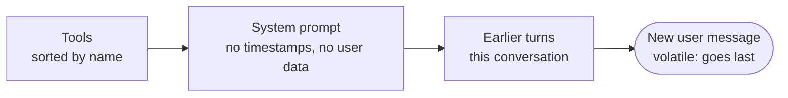

# Observability and cost

An LLM application fails in ways an HTTP dashboard cannot see. The request returned 200, in 4 seconds, and the answer was wrong. Or it was right, and cost forty times what it did last week because a deploy put a timestamp in the system prompt and broke caching. Or a tool loop ran six steps instead of two for one user all afternoon.

You need three views. **Traces**: what happened in this one request. **Metrics**: what is happening in aggregate. **Cost**: what it is costing, per call, per feature and per user. This lesson builds all three, then uses them to make the system cheaper.

**You will learn**

- the shape of a trace for an agent turn, and the standard attribute names that make any backend understand it
- why every model call goes through one instrumented wrapper
- a real async-generator trap with tracing, and how to avoid it
- which metrics and labels to keep, which to avoid, and which alerts to start with
- how to price a call, including cached tokens
- the cost levers in order: measure, prompt caching, response caching, effort and model choice, routing, context size

**Files:** `telemetry.py`, `llm/instrumented.py`, `pricing.py`, `cache.py`, `routing.py`, `api/chat.py`, `ops/alerts.yml`, `docker-compose.observability.yml`.

---

## 1. One trace per chat turn

A trace is a tree of timed spans. For one DocsPilot turn it looks like this:

```text
chat.request                          4.12 s   outcome=ok steps=2 citations=1 cost_usd=0.031
├─ llm.answer                         1.31 s   model=claude-opus-5-5 in=2,041 out=58
│                                              cache_read=0 ttft_s=0.84 stop=tool_use
├─ tool.search_docs                   0.21 s   sources=5
│   └─ retrieval.search               0.20 s   vector_candidates=40 keyword_candidates=23 returned=5
└─ llm.answer                         2.55 s   model=claude-opus-5-5 in=4,388 out=212
                                               cache_read=0 ttft_s=0.92 stop=end_turn
```

Read top to bottom, that trace answers the on-call questions directly. Which model served it, and was it the fallback? How many steps? What did retrieval return? Where did the four seconds go? Was the prompt cache warm? (Here it was not: `cache_read=0` on both calls, which section 6 fixes. The numbers are illustrative; the structure is exactly what the code emits.)

### Standard attribute names

Spans use the OpenTelemetry **GenAI semantic conventions** where they exist: `gen_ai.request.model`, `gen_ai.response.model`, `gen_ai.usage.input_tokens`, `gen_ai.usage.output_tokens`, `gen_ai.response.finish_reasons`. That is what lets Jaeger, Grafana Tempo, Honeycomb or Langfuse render LLM calls sensibly without a custom plugin. Application-specific facts go under your own prefix (`docspilot.cost_usd`, `docspilot.purpose`, `docspilot.cache_read_tokens`).

Export is OTLP over HTTP, configured purely by environment variables, so pointing traces at a different backend is a config change:

```bash
OTEL_EXPORTER_OTLP_ENDPOINT=http://127.0.0.1:4318          # local Jaeger
OTEL_EXPORTER_OTLP_ENDPOINT=https://<langfuse-host>/api/public/otel
OTEL_EXPORTER_OTLP_HEADERS=authorization=Basic%20<base64>   # URL-encoded, per the spec
```

That `%20` is a real bug story: OTLP header values are URL-decoded by spec. A Basic-auth header written with a literal space, or not decoded, gets a 401 from the backend, and traces silently stop arriving with no error in your logs.

### Content is not recorded by default

Prompts and answers contain customer data. Token counts, model, cost and latency are always safe to record; text is not. DocsPilot records content only when `DOCSPILOT_TRACE_CONTENT=true`, and then redacted and truncated:

```python
def content(self, span: Span, key: str, value: str) -> None:
    """Opt-in, redacted, truncated. Never called with credentials by design."""
    if self.trace_content:
        span.set_attribute(f"docspilot.{key}", redact(value)[: self.content_max_chars])
```

Once you turn it on, your tracing backend is a data store holding customer conversations. It needs the same retention, access control and deletion story as your database.

---

## 2. One choke point for every model call

The agent, triage, routing and the eval judge all call the model. If each instrumented itself, one would eventually forget. Instead, instrumentation is a decorator around the `LLM` interface from lesson 01, applied once when the app is built:

```python
# llm/instrumented.py (trimmed)
class InstrumentedLLM:
    def __init__(self, inner: LLM, telemetry: Telemetry) -> None:
        self._inner, self._tel = inner, telemetry

    async def stream(self, request: LLMRequest) -> AsyncGenerator[LLMEvent, None]:
        m = self._tel.metrics
        started, first_token_at, outcome = time.perf_counter(), None, "error"
        served = request.model
        # Not a *current* span: it stays open across yields and may be finalized from
        # another context (client disconnect); explicit end() in `finally` is safe.
        span = self._tel.start(f"llm.{request.purpose}", **{
            "gen_ai.system": "anthropic",
            "gen_ai.request.model": request.model,
            "docspilot.purpose": request.purpose,
            "docspilot.effort": request.effort,
        })
        try:
            async for event in self._inner.stream(request):
                if isinstance(event, TextDelta) and first_token_at is None:
                    first_token_at = time.perf_counter()
                if isinstance(event, LLMResult):
                    served = event.model or request.model
                    outcome = "refusal" if event.refused else "ok"
                    cost = record_llm_usage(m, model=served, purpose=request.purpose,
                                            usage=event.usage,
                                            latency_s=time.perf_counter() - started)
                    if (meter := current_meter.get()) is not None:
                        meter.usd += cost_or_ceiling(served, event.usage)   # per-request budget
                    span.set_attributes({
                        "gen_ai.response.model": served,
                        "gen_ai.usage.input_tokens": event.usage.input_tokens,
                        "gen_ai.usage.output_tokens": event.usage.output_tokens,
                        "docspilot.cache_read_tokens": event.usage.cache_read_input_tokens,
                        "docspilot.cost_usd": cost if cost is not None else -1.0,
                    })
                    if first_token_at is not None:
                        m.llm_ttft.labels(served, request.purpose).observe(first_token_at - started)
                    log.info("llm_call", purpose=request.purpose, model=served,
                             stop_reason=event.stop_reason, cost_usd=cost, **asdict(event.usage))
                yield event
        except LLMError as exc:
            outcome = f"error_{exc.kind}"
            span.record_exception(exc)
            raise
        except (GeneratorExit, asyncio.CancelledError):
            outcome = "cancelled"     # client went away: not an error, excluded from alerts
            raise
        finally:
            m.llm_requests.labels(served, request.purpose, outcome).inc()
            span.set_attribute("docspilot.outcome", outcome)
            span.end()
```

Every call produces exactly three things: a span, a set of metric increments, and one `llm_call` log line with model, purpose, tokens and cost. The **purpose** label (`answer`, `triage`, `route`, `judge`, `smalltalk`) is what lets you say "triage is 3% of spend and the answer path is 94%" instead of guessing.

The model recorded is the model that **served** the call, not the one requested. After a failover (lesson 07) those differ, and a cost metric labelled with the requested model would price the wrong one.

---

## 3. A trap: spans and async generators

This one is subtle enough to deserve its own section, because it produces bugs that look like memory leaks.

The usual tracing API makes a span "current" with a context manager. Everything inside the `with` block, including child spans, attaches to it. But a streaming handler is an async generator, and it **yields** inside that block. When the client disconnects, the generator is finalised later, possibly from a different task and context. Detaching a context that was attached somewhere else raises, the span never ends, and an in-flight gauge stays incremented forever.

```python
# Wrong: a current span held open across yields
async def stream(...):
    with tracer.start_as_current_span("chat.request"):
        async for event in agent.run(...):
            yield event            # disconnect here => detach error, span never ends
```

The fix has two parts. Spans that live across yields are created **without** making them current, and ended explicitly in `finally`. They are **activated** only around each single step of the inner stream, so child spans created during that step still get the right parent:

```python
# api/chat.py
root = tel.start("chat.request", **{"docspilot.request_id": request_id})   # not current
it = events.__aiter__()
try:
    while True:
        try:
            with tel.activate(root):          # current only while fetching one event
                event = await it.__anext__()
        except StopAsyncIteration:
            break
        yield _sse(...)                       # yielded outside the activated block
finally:
    m.in_flight.dec()                         # synchronous bookkeeping first
    root.end()
```

Two related rules from the same review. **Disconnects are not errors**: `GeneratorExit` and `CancelledError` become `outcome="cancelled"`, or a mobile network blip pages you through the error-rate alert. And **telemetry must never break a request**: with no exporter configured, spans are created and go nowhere at no cost.

---

## 4. Metrics, labels and alerts

`/metrics` exposes Prometheus counters and histograms. The core set:

| Metric | Labels | Answers |
|--------|--------|---------|
| `docspilot_llm_requests_total` | model, purpose, outcome | Error rate per model and feature |
| `docspilot_llm_tokens_total` | model, purpose, kind (input, output, cache_read, cache_write) | Where tokens go; cache hit ratio |
| `docspilot_llm_cost_usd_total` | model, purpose | Spend rate |
| `docspilot_llm_time_to_first_token_seconds` | model, purpose | Perceived latency |
| `docspilot_llm_latency_seconds` | model, purpose | Total latency; timeout tuning |
| `docspilot_tool_calls_total` | tool, outcome | Failing tools |
| `docspilot_retrieval_degraded_total` | leg | A retrieval leg silently down |
| `docspilot_cache_requests_total` | result | Response cache hit rate |
| `docspilot_llm_unpriced_total` | model | Calls whose cost is unknown |

Note what is **not** a label: user id. Every distinct label value creates a new time series, and per-user labels mean unbounded cardinality, which takes down a Prometheus server sooner or later. Per-user cost lives in logs, traces and the budget table of lesson 06.

Note also `llm_unpriced_total`. If a new model id appears with no price entry, cost metrics under-report silently, and the spend alert below never fires. A counter of unpriced calls makes that gap visible. **A metric you cannot trust is worse than none.**

Starting alerts, from `ops/alerts.yml`:

```yaml
- alert: LLMErrorRateHigh
  expr: |
    sum(rate(docspilot_llm_requests_total{outcome=~"error.*"}[5m]))
      / sum(rate(docspilot_llm_requests_total[5m])) > 0.05
  for: 10m
- alert: SpendRateHigh
  expr: sum(increase(docspilot_llm_cost_usd_total[1h])) > 20
  annotations: {summary: "More than $20/hour of model spend"}
- alert: RetrievalDegraded
  expr: sum(rate(docspilot_retrieval_degraded_total[10m])) > 0
  for: 15m
- alert: PromptCacheCold
  expr: |
    sum(rate(docspilot_llm_tokens_total{kind="cache_read"}[1h]))
      / sum(rate(docspilot_llm_tokens_total{kind=~"input|cache_read|cache_write"}[1h])) < 0.3
  for: 2h
  annotations: {summary: "Prompt cache hit ratio below 30%: something volatile entered the prefix"}
```

The last two are the AI-specific ones. A degraded retrieval leg produces worse answers with no errors at all. A cold prompt cache produces correct answers at several times the price. Neither would show up on a status-code dashboard.

`docker compose -f docker-compose.yml -f docker-compose.observability.yml up -d` starts Jaeger and Prometheus locally, so you can watch your own traces arrive.

---

## 5. Pricing a call

Cost is computed from usage and a price table. The table is a cached copy of the provider's published prices, and is used for budgets and relative comparisons, so it is re-checked before anyone trusts an absolute number.

```python
# pricing.py
CACHE_READ_MULT = 0.1      # reads cost about a tenth of normal input
CACHE_WRITE_MULT = 1.25    # writing the 5-minute cache costs a quarter more

PRICES: dict[str, Price] = {               # USD per million tokens
    "claude-opus-5-5": Price(4.0, 20.0),
    "claude-sonnet-5-5": Price(2.0, 10.0),
    "claude-haiku-5-5": Price(0.10, 0.50),
    ...
}

def cost_usd(model: str, usage: Usage) -> float | None:
    """None for unknown models: never report a made-up number."""
    price = PRICES.get(model)
    if price is None:
        return None
    return (
        usage.input_tokens * price.input
        + usage.cache_read_input_tokens * price.input * CACHE_READ_MULT
        + usage.cache_creation_input_tokens * price.input * CACHE_WRITE_MULT
        + usage.output_tokens * price.output
    ) / 1_000_000
```

A worked example with that table, for the two-call turn in the trace above, without caching:

```text
call 1   2,041 in × $4/M  + 58 out × $20/M    = $0.0082 + $0.0012 = $0.0093
call 2   4,388 in × $4/M  + 212 out × $20/M   = $0.0176 + $0.0042 = $0.0218
turn                                                              ≈ $0.031
```

Three things to notice. Output tokens cost five times input tokens, but input dominates the bill here because the second call re-sends everything. The second call costs more than twice the first because it carries the retrieved passages. And the same 2,000-token prefix (system prompt plus tools) is paid for twice per turn, and again on every turn of every user, which is what the next section fixes.

For **budgets**, an unknown model is not priced at zero. `cost_or_ceiling` charges it at the most expensive known rate, so adding a new model id can never become a way around a spending cap.

---

## 6. Cost levers, in the order to pull them

### 1. Measure first

Most cost surprises are one feature, one prompt or one runaway loop. Before optimising anything, `sum by (model, purpose)` over the cost counter, and look at `steps` in the `chat_done` logs. A jump in average steps per request is a loop; a drop in the cache-read ratio is a broken prefix. You cannot pull the right lever without knowing which one is attached to the cost.

### 2. Prompt caching

The provider can cache the processed prefix of a prompt. Later requests that start with the same bytes read it at about a tenth of the input price, and with lower latency. The prefix is rendered in a fixed order: **tools, then system, then messages**.



Caching is a **prefix match**. One changed byte early in the prompt invalidates everything after it. Everything about how DocsPilot builds a request follows from that:

- Tools are sorted by name (lesson 02), so their order never changes between requests.
- The system prompt contains no timestamp, no user name, no request id. Per-user or per-request content goes in the messages, after the prefix.
- `cache=True` sets `cache_control: {"type": "ephemeral"}` on the request.
- A test asserts that tools and system are byte-identical across different users' requests:

```python
async def test_cache_prefix_is_identical_across_requests(settings: Settings) -> None:
    """Prompt caching is a prefix match: tools + system must be byte-identical between
    users and requests, or every call is a cache write instead of a read."""
    ...
    answer_reqs = [r for r in llm.requests if r.purpose == "answer"]
    assert all(r.cache for r in answer_reqs)
    assert len({json.dumps(r.tools, sort_keys=False) for r in answer_reqs}) == 1
    assert len({r.system for r in answer_reqs}) == 1
```

Verify in production, not just in tests: `cache_read_input_tokens` should be most of the prefix on every warm call, and the `PromptCacheCold` alert fires when it is not. One more trap: prefixes below the model's minimum cacheable size silently do not cache, with no error.

On the example turn, caching the 1,920-token prefix on both calls changes the input cost from `6,429 × $4/M` to `2,589 × $4/M + 3,840 × $0.40/M`: from about $0.026 to $0.012 for input. Across a day of traffic that is the single largest saving available, for a change of one flag and a sorted list.

### 3. Response caching

A response cache serves a stored answer without calling the model at all. A hit costs nothing and returns instantly. It is also the most dangerous lever here, because a wrong cached answer is served to everyone, confidently, until it expires. DocsPilot's is deliberately narrow:

```python
# cache.py
def normalize(question: str) -> str:
    return _WS.sub(" ", question.strip().lower()).rstrip("?!. ")

def cache_key(question: str, *, prompt_sha: str, model: str, effort: str | None,
              corpus_version: str) -> str:
    raw = "\x1f".join([normalize(question), prompt_sha, model, effort or "", corpus_version])
    return hashlib.sha256(raw.encode()).hexdigest()
```

| Rule | Why |
|------|-----|
| Exact match on the normalised question | "What is the refund window?" and "what is the refund window" hit; paraphrases do not |
| First turn only | Later turns depend on conversation history |
| Prompt sha, model and effort in the key | A new prompt or model can never serve old answers |
| Corpus version in the key | Re-ingesting the docs invalidates every cached answer |
| Only turns that used `search_docs` and nothing else | No ticket lookups, no writes, nothing user-specific |
| TTL plus LRU bound | Staleness and memory both have a hard limit |

The corpus version is a fingerprint of `(path, content_hash, embedding_model)` for every indexed document, refreshed every 30 seconds, so a re-ingest run by a separate process invalidates the cache within half a minute without a restart.

What is **not** done, on purpose: **semantic caching**, returning a stored answer for a question that is merely similar. "Can I get a refund after 20 days on annual?" and "Can I get a refund after 40 days on annual?" are very similar questions with opposite answers. A near miss that confidently returns the wrong policy is worse than paying for the call.

### Don't cache what was produced under failure

The subtlest rule. An answer is stored only if the turn that produced it was entirely healthy:

```python
# api/chat.py
cacheable = (
    cache is not None and slot is not None and slot.allowed
    and event.stop_reason == "end_turn"
    and bool(event.text.strip())
    # grounded in a *healthy* search of the docs, and nothing else:
    and tools == _CACHEABLE_TOOLS            # {"search_docs"}
    and search_ok > 0
    and search_failed == 0
    and not event.flags                      # e.g. degraded_retrieval, injection_removed
    and not event.served_by_fallback
    and event.model == slot.model            # never store a failover answer
)
```

Without that, a "Sorry, I couldn't search the documentation right now" produced during a five-minute embedding outage is cached and served to every user who asks the same question for the next hour.

### 4. Effort and model choice

`effort` is a per-request dial, and the model is a per-purpose choice. DocsPilot answers on the large model at `medium`, classifies with the small model at `low` (40 times cheaper per token in the table above), and judges with the middle one. The `purpose` label shows whether that split is where the money goes.

### 5. Routing

Routing puts a cheap classifier in front of the agent. With `DOCSPILOT_ROUTING=true`, the small model labels the first message; short small talk is answered by the small model with no tools, and everything else goes to the full agent.

```python
# routing.py
async def choose_route(classifier: IntentClassifier, *, message: str) -> Route:
    try:
        intent = await classifier.classify(message)
    except Exception:
        log.warning("routing_failed_open", classifier=classifier.name, exc_info=True)
        return "agent"                       # fail open: the agent can handle anything
    return route_for(intent, message)

def route_for(intent: Intent, message: str) -> Route:
    # Only the unambiguous case is diverted: classified small talk AND short. A long
    # message that mixes a greeting with a real request ("thanks! also open a ticket
    # about...") must reach the agent, which has the tools.
    if intent == "smalltalk" and len(message) <= MAX_SMALLTALK_CHARS:
        return "smalltalk"
    return "agent"
```

Routing is off by default, and the module docstring says why: **it is a trade, not a free win.** Every request that is not small talk now pays an extra classification round trip, in cost and in 300 ms to a second of latency. It only pays off when a large share of traffic is easy. Check `docspilot_route_total` and the eval cost column before turning it on. It also never routes follow-up turns, since a bare "yes" after a ticket offer looks exactly like small talk, and a small-model reply is never written to the shared cache.

### 6. Context size

Retrieval volume (lesson 03) is usually the largest input lever. The 7,000-character budget on search results, and returning 5 chunks instead of 20, bound the second call's size more than any prompt edit could.

---

## What breaks in production

| Symptom | Cause | Where to look |
|---------|-------|---------------|
| Bill doubled, quality unchanged | Cache prefix broke (timestamp in prompt), or a loop | `cache_read` ratio, `steps` per request |
| p95 latency up | Degraded retrieval, fallback model, long tool loops | `retrieval_degraded`, `served_by_fallback`, spans |
| Cache hit ratio is zero | Volatile bytes in the prefix, or prefix below minimum size | Prefix test, `cache_write` tokens |
| Stale answers after a re-index | Response cache outlived the corpus | Corpus version in the key, TTL |
| "Sorry, search is down" served for an hour | Answer cached during an outage | Cacheability conditions |
| Spend alert never fires | New model with no price | `llm_unpriced_total` |
| Customer data in the tracing backend | Content tracing on without redaction or retention | `trace_content`, `redact.py` |
| Spans that never end, gauge stuck high | Current span held across a generator `yield` | `start` + `activate` + `end` in `finally` |

---

## Exercises

1. **Watch a trace.** Start the observability compose file, send three questions, and find them in Jaeger. Which span is the longest? What is the time to first token?
2. **Break the cache.** In `Agent._loop`, where each `LLMRequest` is built, append `f"\nCurrent time: {datetime.now().isoformat()}"` to the system prompt, so it changes on every request. (Appending it once at startup would not: the prompt would be fixed until the next restart.) Which test fails, and on which assertion? What would the `PromptCacheCold` alert show after deploy? Then try `date.today()` instead and explain why it barely matters: the prefix changes once a day, and the cache only lives for minutes.
3. **Price a conversation.** Using the price table, estimate the cost of a five-turn conversation with and without prompt caching. Assume 2,000 tokens of prefix, 4,000 of passages per turn and 250 output tokens per call.
4. **Poison the cache, then fix it.** Remove `and not event.flags` from the cacheability check. Write a test where retrieval is degraded and show the bad answer being served from cache on the next request.
5. **Decide on routing.** Suppose 15% of first messages are small talk. With a classification call costing a tenth of an answer call and adding 0.5 s, is routing worth it on cost? On latency?

---

## Check yourself

<details>
<summary>Why label metrics with the model that served the call rather than the one requested?</summary>

After a failover they differ. Labelling with the requested model would price tokens at the wrong rate and hide that a fallback model is carrying traffic. Cost and latency belong to whoever actually did the work.

</details>

<details>
<summary>Why is a timestamp in the system prompt expensive?</summary>

Prompt caching is a byte-for-byte prefix match over tools, then system, then messages. A timestamp changes the system prompt on every request, so nothing after it can be read from cache: every call becomes a full-price write instead of a tenth-price read.

</details>

<details>
<summary>Why doesn't DocsPilot use semantic caching?</summary>

Similar questions can have opposite answers ("refund after 20 days" versus "after 40 days"). A semantic cache returns a confident answer to a question nobody asked. The exact-match cache gives up some hit rate to make wrong hits impossible.

</details>

<details>
<summary>Routing reduced the average cost per request but users say the bot feels slower. How?</summary>

Every non-small-talk request now waits for a classification call before the agent starts, adding latency to the majority of traffic to save money on a minority. Whether that trade is worth it depends on the share of easy traffic, which is why routing is off by default and measured before enabling.

</details>
