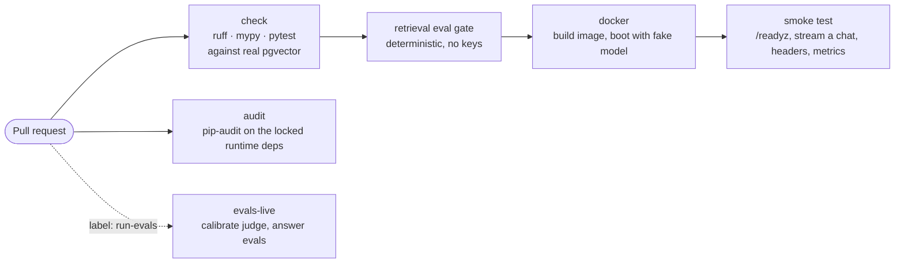
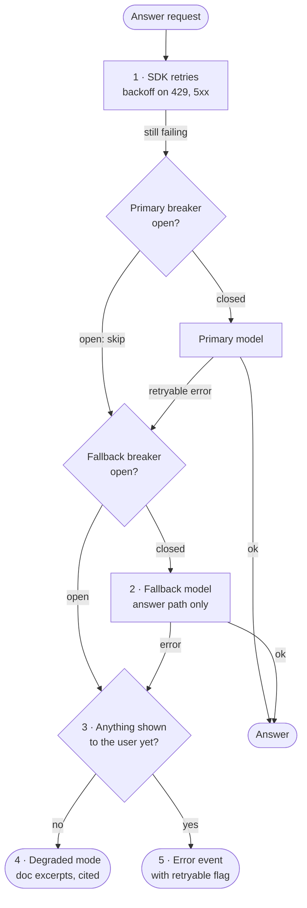
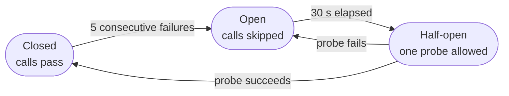

# Shipping

"Works on my machine" is the easy part. Shipping an AI service means four further things. It starts the same way everywhere, and refuses to start when it is misconfigured. It **degrades instead of dying** when the model provider has a bad afternoon. Its state survives restarts and lands on whichever replica the next request reaches. And the person on call at 3 a.m. can answer "why was this answer wrong?" from a trace, with a document that tells them how.

Model providers fail more often than databases do: rate limits during launches, elevated error rates, slow tails, retired model ids. An AI product whose answer to that is a 500 is down whenever its vendor is.

**You will learn**

- a reproducible container image and why production config validation belongs in it
- a CI pipeline that tests the built image, not just the code
- liveness versus readiness for a service whose dependencies degrade
- resilience in five layers: retries, failover, a circuit breaker, degraded mode, an honest error
- the bugs that hide in a circuit breaker and in stream failover
- which state must move to the database before you run two replicas
- what a runbook for an AI service contains

**Files:** `Dockerfile`, `docker-compose.yml`, `.github/workflows/ci.yml`, `llm/resilient.py`, `degraded.py`, `agent/pending_pg.py`, `api/app.py`, `scripts/smoke.py`, `scripts/loadtest.py`, `docs/RUNBOOK.md`, `docs/ARCHITECTURE.md`.

---

## 1. A reproducible artefact

```dockerfile
# syntax=docker/dockerfile:1.7
FROM python:3.12-slim AS builder
COPY --from=ghcr.io/astral-sh/uv:0.13 /uv /usr/local/bin/uv
WORKDIR /app
# dependency layer first: only changes when the lockfile does
COPY pyproject.toml uv.lock ./
RUN --mount=type=cache,target=/root/.cache/uv uv sync --frozen --no-dev --no-install-project
COPY src ./src
RUN --mount=type=cache,target=/root/.cache/uv uv sync --frozen --no-dev

FROM python:3.12-slim
RUN useradd --system --uid 10001 --home-dir /app --shell /usr/sbin/nologin app
WORKDIR /app
COPY --from=builder /app/.venv /app/.venv
COPY src ./src
COPY prompts ./prompts
COPY migrations ./migrations
COPY corpus ./corpus
COPY web ./web
ENV PATH=/app/.venv/bin:$PATH DOCSPILOT_ENV=prod DOCSPILOT_LOG_JSON=true
ARG GIT_SHA=unknown
ENV GIT_SHA=${GIT_SHA}
USER app
HEALTHCHECK --interval=10s --timeout=3s --start-period=20s --retries=5 \
  CMD python -c "import urllib.request; urllib.request.urlopen('http://127.0.0.1:8000/healthz', timeout=2)"
# Graceful shutdown: stop accepting, let in-flight SSE streams finish (up to 30s).
CMD ["uvicorn", "--factory", "docspilot.api.app:create_app", "--host", "0.0.0.0",
     "--port", "8000", "--proxy-headers", "--no-server-header", "--timeout-graceful-shutdown", "30"]
```

The usual container hygiene applies: a multi-stage build with no compilers or tests in the final image, installs from the lockfile with `--frozen`, a dependency layer that is cached until the lockfile changes, and a non-root user. Three choices are specific to this service:

- **Prompts ship in the image.** They are code (lesson 01), so a deploy pins them; nobody edits a prompt on a running server.
- **The image defaults to `DOCSPILOT_ENV=prod`**, which turns on the strict validators: it refuses to start without an API key, a database, a real embedder, authentication, rate limits and budgets. A misconfiguration fails the deploy, not the first customer.
- **The git sha is baked in** and served at `/version`. "Which build answered this?" has a one-request answer.

### Shutdown and long streams

A chat answer can stream for a minute. On a deploy, the orchestrator sends SIGTERM; uvicorn stops accepting connections and gives in-flight streams up to 30 seconds to finish. The orchestrator's own grace period must be **longer** than that, or it kills the process first:

```yaml
# docker-compose.yml
api:
  # uvicorn drains for 30s (--timeout-graceful-shutdown); Docker's default would SIGKILL at 10s
  stop_grace_period: 40s
```

In Kubernetes the same rule is `terminationGracePeriodSeconds` greater than 30, plus readiness-based draining.

---

## 2. CI that tests the image



The `check` job runs tests against a real Postgres with pgvector as a service container, not a mock: vector SQL has enough sharp edges (index usage, operator classes, dimension checks) that a mocked store proves little. The retrieval gate from lesson 04 runs in the same job.

The `docker` job is the one most teams skip. It builds the actual image, boots the stack with the fake model so no secret is needed, and runs a black-box smoke test against it:

```yaml
docker:
  needs: check
  steps:
    - name: "build and start the stack (fake model, no secrets needed)"
      env:
        DOCSPILOT_LLM_BACKEND: fake
        GIT_SHA: ${{ github.sha }}
      run: docker compose up -d --build --wait db api
    - name: smoke test
      run: python3 scripts/smoke.py http://127.0.0.1:8000
    - name: logs on failure
      if: failure()
      run: docker compose logs --no-color api db | tail -200
```

`scripts/smoke.py` uses only the standard library, so it runs anywhere with no install: CI, a laptop, a bastion host after a production deploy. It exits 0 only if the instance is ready, streams a chat answer end to end with a `done` event, returns a request id header, and serves metrics. Unit tests prove the code works; this proves **the artefact you are about to deploy** works: the Dockerfile copied the prompts, the migrations ran, the startup ingest succeeded, the SSE headers survived the server.

`scripts/loadtest.py` does the same at concurrency, reporting p50 and p95 and checking that the in-flight gauge returns to zero afterwards. A gauge that does not return to zero is a leaked stream, which is how the async-generator tracing bug from lesson 05 was found.

---

## 3. Liveness and readiness

Two health endpoints, with deliberately different jobs:

```python
@app.get("/healthz")
async def healthz() -> dict[str, str]:
    """Liveness: the process is up. Must not touch dependencies."""
    return {"status": "ok"}


@app.get("/readyz")
async def readyz() -> JSONResponse:
    """Readiness: can this instance serve? (index reachable and non-empty)"""
    try:
        chunks = await app.state.rag.store.count_chunks()
    except Exception:
        return JSONResponse({"status": "unavailable"}, status_code=503)
    if chunks == 0:
        return JSONResponse({"status": "empty_index"}, status_code=503)
    current = app.state.rag.embedder.name
    stale = [p for p, (_, model) in (await app.state.rag.store.document_state()).items()
             if model != current]
    if stale:  # vectors from another model are incomparable: retrieval would degrade silently
        return JSONResponse({"status": "embedding_model_mismatch", "documents": len(stale)}, 503)
    return JSONResponse({
        "status": "ready",
        "chunks": chunks,
        # informational: an open breaker means failover/degraded mode is active,
        # which is exactly when we still want traffic (not a reason to go unready)
        "breakers": app.state.llm.states(),
    })
```

A liveness check that touches the database turns a database blip into the orchestrator restarting every replica at once. Readiness is where dependencies are checked, and it checks the AI-specific ones: an **empty index** (the service would answer "not found" to everything) and **vectors from a different embedding model** than the one configured (retrieval would silently return nonsense).

Just as important is what readiness does **not** fail on: an open circuit breaker. When the model provider is down, failover and degraded mode are exactly what keep the product useful. Taking every replica out of the load balancer at that moment would turn a degraded service into no service.

---

## 4. Resilience in layers

When the primary model misbehaves, five layers respond in order:



1. **SDK retries** with backoff handle a transient blip within one call (lesson 01).
2. **Failover** to a secondary model on retryable errors, for the answer path only. Triage, routing and the judge are cheap and fail open on their own.
3. **A circuit breaker** per model stops calling a dead dependency, so every user does not wait out the full timeout, and probes for recovery.
4. **Degraded mode** answers from retrieval alone when no model can.
5. **An honest error** event with a `retryable` flag, when even that is impossible.

### Failover

```python
# llm/resilient.py (trimmed)
async def stream(self, request: LLMRequest) -> AsyncGenerator[LLMEvent, None]:
    models = [request.model]
    if request.purpose == "answer" and self._fallback and self._fallback != request.model:
        models.append(self._fallback)

    last_error: LLMError | None = None
    for index, model in enumerate(models):
        breaker = self.breaker(model)
        if not breaker.allow():
            last_error = LLMError(f"circuit open for {model}", kind="overloaded")
            continue
        emitted, settled = False, False
        try:
            async for event in self._inner.stream(replace(request, model=model)):
                if isinstance(event, TextDelta):
                    emitted = True
                if isinstance(event, LLMResult) and model != request.model:
                    # Downstream (cache, logs, eval) must be able to tell this answer
                    # did not come from the model that was asked for.
                    event = replace(event, served_by_fallback=True)
                yield event
            breaker.record_success()
            settled = True
            return
        except LLMError as exc:
            last_error = exc
            # A retired/unknown model id is model-specific: another model can help.
            # Bad requests and auth failures are ours: another model will not.
            if not (exc.retryable or exc.kind == "not_found"):
                raise
            breaker.record_failure()
            settled = True
            if emitted:
                yield StreamReset()        # drop the failed model's partial text
            if index == len(models) - 1:
                raise
        finally:
            if not settled:
                breaker.abort_probe()
    raise last_error
```

Three decisions in there are worth naming:

- **Which errors fail over.** Retryable ones (overloaded, rate limited, timeout, server) and `not_found`, because a retired model id is specific to that model. A `bad_request` or `auth` error is your fault, and sending the same broken request to a second model only doubles the failure.
- **Partial text is discarded explicitly.** If the primary streamed half an answer and then failed, the client must throw that half away before the fallback's answer arrives. `StreamReset` becomes an SSE `reset` event, and the API layer also resets everything it buffered for that step: the output guard's held-back tail, and the count of characters the user has seen. A partial word glued onto the start of the next answer is a real bug class.
- **A failover answer is a different product.** It is marked `served_by_fallback`, never written to the shared response cache (the cache key was built for the primary), labelled with the serving model in metrics, and counted by `docspilot_llm_failover_total`.

Instrumentation sits **inside** failover (`Resilient(Instrumented(Anthropic))`), so each attempt gets its own span and its own cost. The failed primary attempt did consume tokens, and the budget should know.

### The circuit breaker

Without a breaker, a dead provider means every request waits for the full timeout before failing over, and your service adds load to a provider that is trying to recover. A breaker remembers recent failures and skips the call entirely.



```python
class CircuitBreaker:
    @property
    def state(self) -> str:
        if self._opened_at is None:
            return "closed"
        if self._clock() - self._opened_at >= self._recovery:
            return "half_open"
        return "open"

    def allow(self) -> bool:
        state = self.state
        if state == "closed":
            return True
        if state == "half_open" and not self._probing:
            self._probing = True               # exactly one probe at a time
            return True
        return False

    def abort_probe(self) -> None:
        """The probe ended without a verdict (cancelled, bad request, crashed): free the
        slot so the next request can probe, without changing the breaker's state."""
        self._probing = False

    def record_success(self) -> None:
        self._failures, self._opened_at, self._probing = 0, None, False

    def record_failure(self) -> None:
        self._probing = False
        self._failures += 1
        if self._failures >= self._threshold or self._opened_at is not None:
            self._opened_at = self._clock()
```

The bug review found here is a good one. In the half-open state, exactly one request is allowed through as a probe. If that probe ends **without a verdict**, because the client disconnected, or it was a bad request, or the code raised something unexpected, then neither `record_success` nor `record_failure` runs, and `_probing` stays true forever. The breaker is now permanently half-open with its only probe slot taken: the model is disabled until the process restarts. `abort_probe()` in a `finally` releases the slot. Note also that cancellations and bad requests are not evidence about the **provider**, so they must not count as failures either.

Breakers are per replica, by design. Each replica learns about the outage on its own within a few requests; sharing breaker state across replicas adds a dependency to the failure path for little gain.

---

## 5. Degraded mode

When no model can answer, retrieval still can. For a documentation assistant, the most relevant doc excerpts, clearly labelled and cited, are far more useful than an error. They cost no tokens, arrive instantly and cannot hallucinate.

```python
# degraded.py
NOTICE = ("The assistant can't generate an answer right now. These documentation sections look "
          "most relevant to your question:")

async def degraded_answer(retriever, question, policy, *, max_items: int = 3):
    result = await retriever.search(question)
    if not result.hits:
        return None
    lines, citations, seen = [NOTICE, ""], [], set()
    for hit in result.hits:
        c = hit.chunk
        if c.path in seen:
            continue
        seen.add(c.path)
        # Same hygiene as the tool path: excerpts, titles and headings are document text.
        excerpt = " ".join(neutralize(c.text, policy)[0].split())[:300]
        title = defang(neutralize(c.title, policy)[0])[:200]
        lines.append(f"- {title} > {c.heading_path.split(' > ')[-1]} [{c.path}]")
        lines.append(f"  {excerpt}")
        citations.append({"path": c.path, "title": title, "section": c.heading_path})
        if len(citations) >= max_items:
            break
    return "\n".join(lines), citations
```

The API layer uses it under strict conditions:

```python
# api/chat.py, in the LLMError handler
if degrade is not None and exc.retryable and sent_chars == 0:
    # Generation is down but nothing has been shown yet: answer from retrieval.
    fallback = await degrade()
if fallback is not None and check_output(fallback[0], allowed_hosts).ok:
    yield _sse("delta", {"text": text_out})
    yield _sse("citations", {"sources": cites})
    yield _sse("done", {"stop_reason": "degraded", "degraded": True, ...})
```

- **Only for retryable errors.** A bad request is a bug, not an outage.
- **Only if nothing has been shown yet.** Replacing half an answer with doc excerpts mid-sentence is worse than an error.
- **Still guarded.** The excerpts pass through the injection scanner and the output guard like any other text the user sees.
- **Never cached, and refunded.** The budget reservation is returned, since nothing was spent. Otherwise the guard rail would lock users out exactly when the outage ends.

---

## 6. State that survives a deploy

The moment you run two replicas, or deploy with a rolling update, any state in process memory is a bug waiting for the right timing. Go through every piece of state and decide where it lives:

| State | Store | Why there |
|-------|-------|-----------|
| Documents, chunks, vectors | Postgres | Re-ingest is idempotent and runs on deploy |
| Tickets, feedback | Postgres | Durable; idempotent writes |
| **Pending confirmations** | Postgres | An approval can land on a different replica than the proposal |
| Daily spend | Postgres | Budgets must be global across replicas |
| Response cache | Process memory | Optimisation: a miss costs money, not correctness |
| Rate limiter | Process memory | Guard rail: per-replica limits are slightly looser, not wrong |
| Circuit breakers | Process memory | Each replica learns the outage on its own quickly |

The pending confirmations are the instructive case. In lesson 02 they lived in memory. With two replicas, the user's "approve" click has a 50% chance of reaching a replica that has never heard of the pending action and returns 404. With a rolling deploy, every user mid-confirmation loses their pending ticket.

Moving them to Postgres needs three things. The SDK content blocks, including reasoning blocks, are stored as JSON and replayed as plain dictionaries. The claim is a single conditional `UPDATE`, shown in lesson 02, so two replicas racing for the same confirmation cannot both execute it. And TTLs use the **database clock**, not each replica's, so replicas with skewed clocks agree on when a confirmation expires:

```python
# agent/pending_pg.py
async def put(self, pending: PendingAction) -> None:
    async with self._pool.connection() as conn, conn.transaction():
        await conn.execute("DELETE FROM pending_actions WHERE expires_at < extract(epoch from now())")
        # TTL is applied on the database clock: replicas with skewed clocks must
        # not shift when a confirmation expires.
        ttl = max(pending.expires_at - time.time(), 0.0)
        await conn.execute(
            "INSERT INTO pending_actions (id, user_id, payload, expires_at) "
            "VALUES (%s, %s, %s, extract(epoch from now()) + %s)",
            (pending.id, pending.user_id, Jsonb(encode(pending)), ttl))
```

And the in-memory entries that remain are each a deliberate decision with a stated failure mode: "slightly less effective", never "wrong".

### Bookkeeping in `finally` must be shielded

One more bug class that only appears in production. When a client disconnects, the server cancels the request's task. Code in a `finally` block then runs inside a cancelled scope, and the first `await` in it raises `CancelledError` immediately. An unshielded `await store.release(pending)` is silently skipped, leaving the confirmation claimed forever; an unshielded budget settlement loses the spend. DocsPilot runs that bookkeeping as a detached, shielded task:

```python
async def _shielded(awaitable: Awaitable[None]) -> None:
    """Run bookkeeping to completion even if the calling task is being cancelled."""
    task = asyncio.ensure_future(awaitable)
    _BACKGROUND.add(task)                      # keep a reference: no GC mid-flight
    task.add_done_callback(_BACKGROUND.discard)
    try:
        await asyncio.shield(task)
    except asyncio.CancelledError:
        pass                                   # the task keeps running; we are being torn down
```

Outcomes are also checkpointed immediately after each side effect, not at the end, so a crash between the write and the end of the turn loses nothing.

---

## 7. The runbook

Operability is a document as much as code. `docs/RUNBOOK.md` exists so that the person on call does not have to understand the codebase to act. Its most important section, and the one specific to AI services, is debugging a bad answer.

### "The answer was wrong"

1. **Get the request id.** From the user's report, a thumbs-down row in `feedback`, or a log search. It is in the `X-Request-ID` header, the `done` event and the trace id.
2. **Open the trace** and check, in order:
   - `llm.answer` spans: requested model versus served model (was it the fallback?), cost, finish reason.
   - `retrieval.search`: candidate counts and how many passages were returned. Zero or degraded retrieval explains most bad answers.
   - `tool.search_docs`: which documents the model was shown.
3. **Reproduce retrieval alone** with `GET /v1/debug/search?q=<the question>` (non-production).
4. **Classify and fix:**

| Finding | Fix |
|---------|-----|
| Right document not retrieved | Chunking, query or keyword terms; add a golden case; `make eval-retrieval` |
| Right document retrieved, answer wrong | The prompt version in the log; add a golden case; `make eval-answers` |
| Old policy quoted | Contradicting document in the corpus; check `updated`; cache TTL |
| Cited source does not exist | Impossible by design (citations are validated): treat as a bug |

5. **Turn the case into a regression test** in `evals/golden.jsonl`.

### Provider outage

Symptoms: `llm_failover` and `degraded_answer` log events, the error-rate metric up, an `open` breaker in `/readyz`. For a short outage, do nothing: failover and degraded mode keep the product up and the breaker probes for recovery every 30 seconds. **Do not raise timeouts or retries during an incident**: it multiplies the requests in flight against a provider that is already struggling.

### Cost spike

```text
sum(increase(docspilot_llm_cost_usd_total[1h])) by (model, purpose)
```

Then per request: `chat_done` log lines carry `cost_usd`, `steps` and token counts. A jump in steps means a loop. A drop in the cache-read ratio means a deploy put something volatile in the prompt prefix. Per user:

```sql
SELECT user_id, cost_usd FROM usage_daily WHERE day = current_date ORDER BY 2 DESC LIMIT 20;
```

Mitigations that need no code change: lower the per-user or global daily budget, or enable routing.

### Deploy and rollback

Migrations are forward-only and applied at startup under a Postgres advisory lock, so two replicas starting together do not both run them. They are written to be compatible with the previous release, so rollback is simply redeploying the previous image. Pending confirmations survive it, because they are in Postgres.

---

## What breaks in production

| Symptom | Cause | Where to look |
|---------|-------|---------------|
| Container restarts at boot | Strict config validation: a missing key, database, limit or budget | Container logs: the validator names the setting |
| Approval returns 404 after a deploy | Pending store in memory, or TTL expired | `pending_actions` table, `confirmation_ttl_s` |
| Everything slow during a provider incident | No breaker, or timeouts too high | `breakers` in `/readyz`, `llm_failover` logs |
| A model disabled until restart | Half-open breaker leaked its probe slot | `abort_probe()` in `finally` |
| Users see doc excerpts instead of answers | Degraded mode active | `docspilot_degraded_answers_total`, provider status |
| Answer starts with a fragment of another answer | Buffers not reset on `StreamReset` | Guard tail and sent-character counters |
| Streams cut off at every deploy | Orchestrator grace period shorter than the drain | `stop_grace_period`, `terminationGracePeriodSeconds` |
| Users locked out right after an outage | Failed requests kept their budget reservations | Refund on failure and degraded mode |

---

## Exercises

1. **Run the smoke test against the image.** `DOCSPILOT_LLM_BACKEND=fake docker compose up -d --build --wait`, then `python3 scripts/smoke.py http://127.0.0.1:8000`. Now delete the `COPY prompts` line from the Dockerfile and run it again. Which step fails, and would unit tests have caught it?
2. **Trip the breaker.** With `FakeLLM` raising `overloaded` on the primary, send six requests. Assert the sixth never calls the primary and is served by the fallback with `served_by_fallback=True`.
3. **Leak a probe.** Remove `abort_probe()` from the `finally`. Write a test where the half-open probe is cancelled, and show that the model is never called again.
4. **Force degraded mode.** Make both models fail and ask a question. Check the response: stop reason, citations, and that the budget reservation was refunded.
5. **Two replicas.** Run two API containers behind any load balancer, propose a ticket on one and approve it on the other. Then swap in the in-memory pending store and repeat.

---

## Check yourself

<details>
<summary>Why does <code>/readyz</code> stay ready when a circuit breaker is open?</summary>

Because an open breaker means failover or degraded mode is handling requests, which is exactly when users still need the service. Failing readiness would pull every replica out of the load balancer and turn a degraded product into an outage.

</details>

<details>
<summary>Why fail over on <code>not_found</code> but not on <code>bad_request</code>?</summary>

`not_found` usually means that model id was retired or is unavailable, which is specific to that model, so another model can serve the request. A `bad_request` means the request itself is malformed; the second model will reject it too.

</details>

<details>
<summary>What goes wrong if the half-open probe is cancelled and nothing calls <code>abort_probe()</code>?</summary>

The breaker stays half-open with its single probe slot marked as taken. `allow()` returns false for every later request, so the model is never called again until the process restarts, even after the provider has recovered.

</details>

<details>
<summary>Why are pending confirmations in Postgres while the response cache stays in memory?</summary>

A lost pending confirmation is a correctness bug: the user's approval 404s or the action is lost on deploy. A response cache miss on another replica only costs a model call. State whose loss is wrong goes in the shared store; state whose loss is merely less efficient can stay local.

</details>
