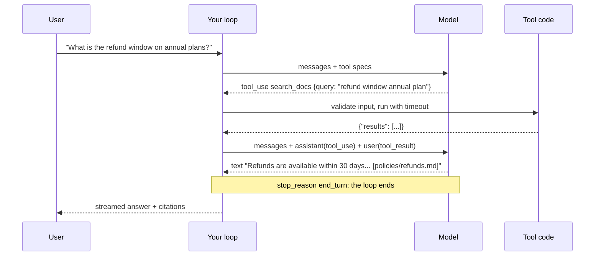
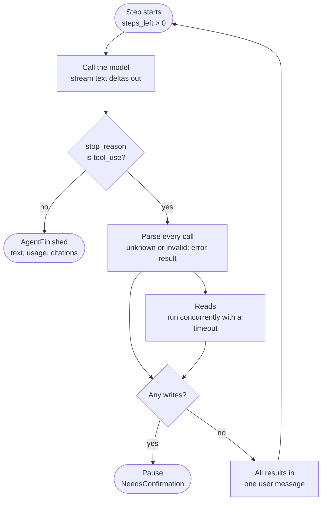
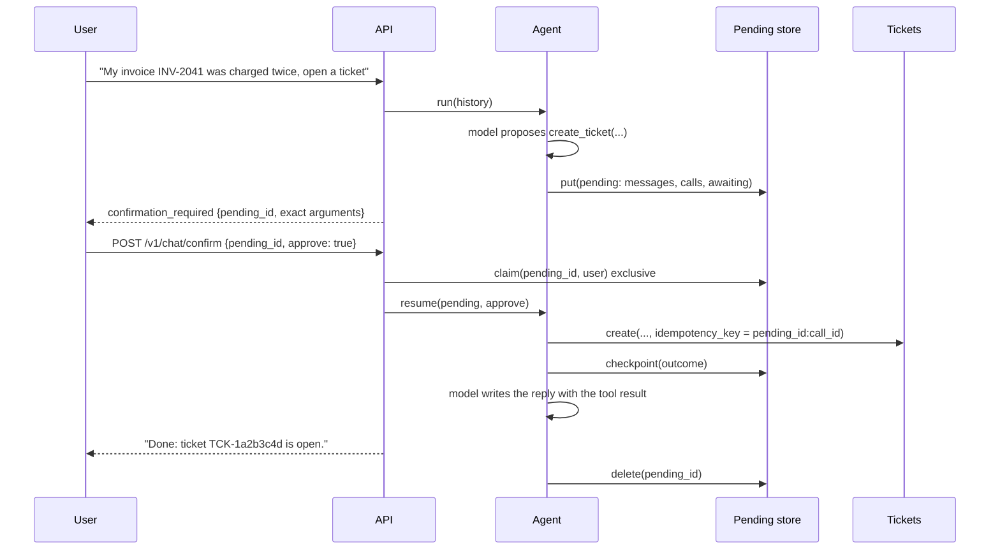

# Tools and agents

A model on its own can only produce text. Tool use lets it ask your code to do something: search the docs, look up a ticket, open one. The model never executes anything. It emits a structured request, your code decides whether and how to run it, and the result goes back as the next message. An **agent** is nothing more than that exchange in a loop.

Frameworks wrap this loop. Writing it yourself once is the fastest way to understand what they do, and what they cannot do for you: decide which calls are safe, bound the loop, and make a write happen exactly once.

**You will learn**

- the tool-use protocol, message by message
- how to define a tool once, as a typed model that is both the schema the model sees and the validator you run
- the six things that separate a production loop from the tutorial version
- how to put a human between the model and any side effect, without letting the client tamper with what was approved
- the failure semantics of a confirmed write: claim, idempotency key, replay
- when to use structured output instead of a tool

**Files:** `agent/loop.py`, `agent/tools.py`, `agent/pending.py`, `agent/pending_pg.py`, `tickets_pg.py`, `triage.py`.

---

## 1. The protocol

You send the model a list of tools, each with a name, a description and a JSON schema for its input. When the model wants one, it stops generating text and returns a `tool_use` block with `stop_reason == "tool_use"`. You run the tool and reply with a `tool_result` block that references the call's id. The model continues from there.



In messages, one round trip looks like this. Note that the tool result travels in a **user** message, and that the assistant turn is sent back exactly as the model produced it:

```json
[
  {"role": "user", "content": "What is the refund window on annual plans?"},
  {"role": "assistant", "content": [
    {"type": "tool_use", "id": "toolu_01", "name": "search_docs",
     "input": {"query": "refund window annual plan"}}
  ]},
  {"role": "user", "content": [
    {"type": "tool_result", "tool_use_id": "toolu_01",
     "content": "{\"results\": [{\"source\": \"policies/refunds.md\", ...}]}"}
  ]}
]
```

The toy version of the loop fits in ten lines:

```python
while True:
    result = await complete(llm, LLMRequest(model=MODEL, messages=messages, tools=specs))
    if result.stop_reason != "tool_use":
        return result.text
    messages.append({"role": "assistant", "content": result.content})
    outputs = [await TOOLS[c.name](**c.input) for c in result.tool_calls]
    messages.append({"role": "user", "content": [
        {"type": "tool_result", "tool_use_id": c.id, "content": json.dumps(o)}
        for c, o in zip(result.tool_calls, outputs)
    ]})
```

Everything wrong with it is the rest of this lesson. It loops forever if the model keeps calling tools. It crashes on a misspelled tool name or a bad argument. One hung tool hangs the request. It runs calls one by one. A tool's exception, with its stack trace and connection string, goes nowhere useful. And it executes writes the moment the model asks.

---

## 2. Define a tool once

Every tool in DocsPilot has a Pydantic input model. That one class is three things at once: the JSON schema sent to the model, the validator for whatever the model sends back, and the typed object your tool code receives.

```python
# agent/tools.py
class ToolInput(BaseModel):
    # extra="forbid" => additionalProperties:false, which strict tool use requires.
    model_config = ConfigDict(extra="forbid")


class Tool(ABC):
    name: str
    description: str
    input_model: type[ToolInput]
    #: Side-effecting tools never run until a human approves the exact arguments.
    requires_confirmation: bool = False

    def spec(self) -> dict[str, Any]:
        return {
            "name": self.name,
            "description": self.description,
            "input_schema": anthropic.transform_schema(self.input_model),
            "strict": True,
        }

    @abstractmethod
    async def run(self, args: Any, ctx: ToolContext) -> dict[str, Any]: ...
```

`strict: True` turns on constrained decoding for the arguments: the model cannot produce JSON that violates the schema's structure. Some constraints, such as string lengths and regex patterns, are not enforced by strict decoding, so Pydantic still validates everything on your side. The rule for the whole lesson: **the model proposes, your code disposes.**

Here is the ticket tool. Read the descriptions as what they are: prompt text, placed in the most influential part of the context.

```python
class CreateTicketInput(ToolInput):
    title: str = Field(min_length=3, max_length=120, description="Short summary of the problem.")
    description: str = Field(
        min_length=10, max_length=2000,
        description="What happened, what the user expected, and any ids or error codes.",
    )
    severity: Severity = Field(
        description="low: question or cosmetic; normal: blocked on a non-critical task; "
        "high: money is wrong, data loss, or the user cannot bill customers at all."
    )


class CreateTicketTool(Tool):
    name = "create_ticket"
    description = (
        "Open a support ticket for the human support team. Call only when the user has "
        "clearly asked to open or escalate a ticket (or you offered and they accepted) and "
        "you have enough detail to write a useful title and description. The user is shown "
        "the ticket and must approve it before it is created, so do not claim it exists "
        "until you receive the tool result."
    )
    input_model = CreateTicketInput
    requires_confirmation = True

    def summarize(self, args: Any) -> str:
        return f"Open a {args.severity}-severity ticket: “{args.title}”"
```

A good tool description says **when to call it, when not to, and what the result means**. "Opens a ticket" is a bad description. The one above stops the model opening tickets nobody asked for, tells it what makes a useful ticket, and warns it not to claim success early. The `severity` field description is a rubric, so the model picks `high` for the same reasons a support lead would.

The read tool's input carries one more instruction, which quietly solves multi-turn search:

```python
class SearchDocsInput(ToolInput):
    query: str = Field(
        min_length=2, max_length=300,
        description="Specific, self-contained search query using product terms. "
        "Do not use pronouns or refer to earlier messages.",
    )
```

When the user follows "What's the refund window?" with "and for annual plans?", the model sees the whole conversation and writes `"refund window annual plan"`. That is query rewriting, done by the model you already called, for free.

The registry sorts tools by name. That looks cosmetic and is not: the tool list is the first thing in the prompt, and prompt caching (lesson 05) only works when the prefix is byte-identical on every request.

```python
class ToolRegistry:
    def __init__(self, tools: list[Tool], telemetry: Telemetry | None = None) -> None:
        names = [t.name for t in tools]
        if len(set(names)) != len(names):
            raise ValueError("duplicate tool names")
        # Sorted: a deterministic tool list keeps the prompt-cache prefix stable.
        self._tools = {t.name: t for t in sorted(tools, key=lambda t: t.name)}
```

---

## 3. Validate, bound and contain

Two methods sit between the model's request and your tool code. `parse` validates; `execute` runs with a timeout and turns every failure into a result the model can read.

```python
def parse(self, name: str, raw: dict[str, Any]) -> tuple[Tool, ToolInput] | ToolOutcome:
    """Validate model-proposed input. On failure return an error the model can act on."""
    tool = self._tools.get(name)
    if tool is None:
        return ToolOutcome(f"Unknown tool '{name}'. Available: {', '.join(self._tools)}", True)
    try:
        return tool, tool.input_model.model_validate(raw)
    except ValidationError as exc:
        problems = "; ".join(
            f"{'.'.join(str(p) for p in e['loc']) or 'input'}: {e['msg']}" for e in exc.errors()
        )
        return ToolOutcome(f"Invalid arguments for {name}: {problems}", True)
```

A validation failure is not an exception. It goes back to the model as a `tool_result` with `is_error: true`, and the message says exactly what was wrong (`ticket_id: String should match pattern '^TCK-[0-9a-f]{8}$'`). Models fix their own arguments well when told precisely what broke.

```python
async def _execute(self, tool, args, ctx, *, timeout_s: float) -> ToolOutcome:
    try:
        output = await asyncio.wait_for(tool.run(args, ctx), timeout=timeout_s)
    except ToolError as exc:
        return ToolOutcome(str(exc), True)                 # expected, safe to show
    except TimeoutError:
        if tool.requires_confirmation:
            # Outcome unknown: a blind retry could duplicate the side effect.
            return ToolOutcome(f"{tool.name} timed out and its outcome is unknown. "
                               "Do not retry; tell the user to check before trying again.", True)
        return ToolOutcome(f"{tool.name} timed out. You may retry once.", True)
    except Exception:
        # Never leak internals to the model (it may repeat them to the user).
        log.exception("tool_failed", tool=tool.name)
        return ToolOutcome(f"{tool.name} failed due to an internal error.", True)
    text = json.dumps(output, ensure_ascii=False, default=str)
    if len(text) > MAX_TOOL_OUTPUT_CHARS:
        # Stays valid JSON so the model can tell it was cut.
        text = json.dumps({"truncated": True, "preview": text[: MAX_TOOL_OUTPUT_CHARS - 200]})
        return ToolOutcome(text)
    return ToolOutcome(text, sources=tool.sources(output))
```

Each branch is a production lesson:

- **`ToolError`** is the channel for expected failures with a message worth showing (`No ticket TCK-1a2b3c4d found for this user`).
- **A timed-out read** may be retried once. **A timed-out write** may not: the ticket might exist. The message tells the model so in words, because the model is the one deciding what to do next.
- **An unexpected exception** is logged in full for you and reported as one bland line to the model. Anything you put in a tool result can end up quoted to the user.
- **Oversized output** is cut to a budget and still valid JSON. A truncated JSON document confuses the model far more than a short one.

Notice also what `get_ticket` does when a ticket belongs to someone else:

```python
ticket = await ctx.tickets.get(args.ticket_id, user_id=ctx.user_id)
if ticket is None:
    # Same message for "missing" and "someone else's": no existence oracle.
    raise ToolError(f"No ticket {args.ticket_id} found for this user.")
```

The user id comes from the authenticated request via `ToolContext`, never from the model's arguments. The model cannot ask for another user's ticket because it has no way to name another user.

---

## 4. The production loop

Here is `Agent._loop`, trimmed of telemetry. It yields events rather than returning text, so the API layer can stream them.

```python
# agent/loop.py
async def _loop(self, messages, ctx, *, steps_left: int, usage=None, steps=0, retrieved=None):
    usage = usage or Usage()
    while steps_left > 0:
        steps += 1
        steps_left -= 1
        request = LLMRequest(model=cfg.model, system=cfg.system, messages=messages,
                             tools=self._registry.specs() or None, effort=cfg.effort,
                             cache=cfg.prompt_caching, purpose="answer")
        result = None
        async with aclosing(self._llm.stream(request)) as llm_stream:
            async for event in llm_stream:
                if isinstance(event, LLMResult):
                    result = event
                else:
                    yield event                       # TextDelta: stream it straight through
        usage += result.usage

        if result.stop_reason != "tool_use" or not result.tool_calls:
            yield AgentFinished(result.stop_reason, usage, steps, result.model, text=result.text,
                                citations=extract_citations(result.text, retrieved), ...)
            return

        messages.append({"role": "assistant", "content": result.content})   # raw blocks
        outcomes, awaiting, runnable = {}, [], []
        for call in result.tool_calls:
            parsed = self._registry.parse(call.name, call.input)
            if isinstance(parsed, ToolOutcome):
                outcomes[call.id] = parsed            # bad call: the error goes back
            elif parsed[0].requires_confirmation:
                awaiting.append(call.id)              # a write: needs a human
            else:
                runnable.append((call, *parsed))

        for call, outcome, ms in await self._run_concurrently(runnable, ctx):
            outcomes[call.id] = outcome

        if awaiting:
            yield await self._pause(messages, result, outcomes, awaiting, ...)
            return
        messages.append(self._results_message(result.tool_calls, outcomes))

    yield AgentFinished("max_steps", usage, steps, cfg.model)
```

One step of that loop, as a picture:



The six differences from the toy loop:

| Concern | How the loop handles it |
|---------|-------------------------|
| **Runaway loops** | A hard step budget (`max_steps`, 6 here). A model that keeps calling a failing tool ends with `max_steps`, which the API turns into an honest error. |
| **Hung tools** | Per-call timeout; the timeout becomes an error result, not a hung request. |
| **Parallel calls** | Read tools run with `asyncio.gather`. Three 200 ms searches take 200 ms, not 600. |
| **All results together** | Every result goes back in **one** user message. Splitting them across messages teaches the model that parallel calls do not work, and it stops making them. |
| **Bad model input** | Validation errors return as `is_error` results the model can correct. |
| **Tool bugs** | Contained: the model sees "internal error", you see the stack trace in the logs. |

```python
async def _run_concurrently(self, runnable, ctx):
    async def one(call, tool, args):
        started = time.perf_counter()
        outcome = await self._registry.execute(tool, args, ctx,
                                               timeout_s=self._config.tool_timeout_s)
        return call, outcome, round((time.perf_counter() - started) * 1000, 1)
    return list(await asyncio.gather(*(one(c, t, a) for c, t, a in runnable)))

@staticmethod
def _results_message(calls, outcomes) -> dict[str, Any]:
    # One user message with *all* results: splitting them teaches the model to stop
    # making parallel calls.
    return {"role": "user",
            "content": [_tool_result_block(c.id, outcomes[c.id]) for c in calls]}
```

### Citations are output, so they are checked

The loop also enforces a rule from the prompt. The model is told to cite sources as `[policies/refunds.md]`. A model can cite a page that does not exist, or one it never retrieved. So citations are parsed out of the answer and kept only if that path was actually returned by a tool **in this turn**:

```python
def extract_citations(text: str, retrieved: dict[str, Source]) -> tuple[Source, ...]:
    """Citations are model output, so they are untrusted: keep only paths that were
    really retrieved this turn. A hallucinated path never reaches the user as a source."""
    out: dict[str, Source] = {}
    for group in _BRACKET.findall(text):
        for part in re.split(r"[;,]", group):       # "[a.md, b.md]", "[a.md#section]"
            path = part.strip().removeprefix("source:").split("#", 1)[0].strip()
            if path in retrieved:
                out.setdefault(path, retrieved[path])
    return tuple(out.values())
```

This is a pattern you will see again: whatever the model writes that your system acts on, whether a citation, a URL, an argument or a ticket title, is checked by code before it counts.

---

## 5. A human between the model and every side effect

Reads are safe to run on the model's say-so. Writes are not. A model can misread intent, be manipulated by a document (lesson 06), or simply be wrong about severity. The design rule: **the model may suggest actions; only an authenticated human authorises them.**

When the loop meets a write, it does not run it. It parks the whole conversation state on the server under a random, single-use, expiring id, streams the exact arguments to the client, and stops.

```python
async def _pause(self, messages, result, outcomes, awaiting, ctx, steps_left, usage, steps,
                 retrieved) -> NeedsConfirmation:
    pending = PendingAction(
        id=self._pending.new_id(),                 # secrets.token_urlsafe(24)
        user_id=ctx.user_id,
        messages=messages,                         # including the raw tool_use blocks
        calls=result.tool_calls,
        completed=outcomes,                        # reads that already ran
        awaiting=awaiting,                         # the writes waiting for a decision
        steps_left=steps_left,
        expires_at=time.time() + self._ttl,        # 10 minutes
        usage=usage, steps=steps, retrieved=retrieved,
    )
    await self._pending.put(pending)
    items = [ConfirmItem(c.id, c.name, c.input, tool.summarize(args)) for ...]
    return NeedsConfirmation(pending.id, items, self._ttl)
```

The client receives:

```text
event: confirmation_required
data: {"pending_id": "q8Xr...", "expires_in_s": 600, "items": [{"tool": "create_ticket",
       "summary": "Open a high-severity ticket: “Invoice INV-2041 charged twice”",
       "arguments": {"title": "...", "description": "...", "severity": "high"}}]}
```

The user approves or declines, and the client sends back two fields, nothing more:

```python
class ConfirmRequest(BaseModel):
    pending_id: Annotated[str, StringConstraints(pattern=r"^[A-Za-z0-9_-]{16,64}$")]
    approve: bool
```

**The client never sends the arguments back.** The server runs the arguments it stored. A modified client, or a prompt injection that somehow got the browser to post, cannot change what was approved.



### At most once, even when everything fails around it

The interesting part is not the happy path. A confirmed write must run **at most once** across double clicks, retries, crashes and a follow-up model call that fails. Four mechanisms combine:

1. **Claim, don't pop.** `claim` takes exclusive processing rights for 60 seconds. A second request for the same id while it is held gets `409 Conflict`, not a second execution. In Postgres the claim is a single conditional `UPDATE`, so two replicas racing for the same confirmation cannot both win (shown with the timeout inlined):

   ```sql
   UPDATE pending_actions
      SET claimed_until = extract(epoch from now()) + 60
    WHERE id = $1 AND user_id = $2
      AND expires_at > extract(epoch from now())
      AND claimed_until <= extract(epoch from now())
   RETURNING payload;
   ```

   Note `user_id` in the `WHERE`: someone else's pending id behaves exactly like an unknown one. And the clock is the database's, so replicas with skewed clocks agree on expiry.

2. **An idempotency key per call.** The tool runs with `pending_id:call_id` as its key, and the tickets table has a unique constraint on it. If the process crashes after inserting the ticket but before recording that it did, the retry hits the constraint and gets the original ticket back:

   ```python
   cur = await conn.execute("""
       INSERT INTO tickets (id, user_id, title, description, severity, idempotency_key, fingerprint)
       VALUES (%s, %s, %s, %s, %s, %s, %s)
       ON CONFLICT (idempotency_key) DO NOTHING
       RETURNING ...""", (...))
   if (row := await cur.fetchone()) is None:
       existing = ...   # key already used: return the original unless the arguments differ
       if existing.fingerprint != fp:
           raise IdempotencyConflictError(idempotency_key)
   ```

3. **Checkpoint immediately after the side effect.** The outcome is saved to the pending entry right after the write, before the follow-up model call.

4. **Resolved entries replay instead of re-executing.** The entry is deleted only when the follow-up turn **finishes**. If the model call after the write fails, or the client disconnects, the entry survives with its recorded outcome. A retry skips straight to the model with the stored result.

```python
# agent/loop.py, in resume()
waiting = [c for c in pending.calls
           if c.id in pending.awaiting and c.id not in pending.completed]
for call in waiting:
    if not approve:
        pending.completed[call.id] = ToolOutcome(DECLINED)
        continue
    keyed = ctx.with_key(f"{pending.id}:{call.id}")
    outcome = await self._registry.execute(tool, args, keyed, timeout_s=...)
    pending.completed[call.id] = outcome
    # Persist right away: a crash after the side effect must not forget it.
    await _shielded(self._pending.checkpoint(pending))
pending.awaiting = []   # resolved: a retry replays instead of re-executing
```

One more subtle rule: the pause itself used a step of the budget. On resume the loop always leaves at least one step (`max(pending.steps_left, 1)`), or a user who approves a ticket would be rewarded with "That took too many steps".

A declined write is also a tool result. The model reads "The user declined this action. Do not retry it; acknowledge and offer alternatives." and continues the conversation like a person would.

---

## 6. Structured output: when you want data, not action

Not every model call is a conversation. The `/v1/triage` endpoint classifies a support message into a typed object. That is not a tool, because nothing is being fetched or done. It is **structured output**: the response is constrained to a JSON schema.

```python
# triage.py
class Triage(BaseModel):
    model_config = ConfigDict(extra="forbid")
    intent: Literal["question", "ticket_request", "complaint", "smalltalk", "other"]
    urgency: Literal["low", "normal", "high"]
    product_area: Literal["billing", "invoices", "payments", "api", "security", "account", "other"]
    # Decoding cannot enforce maxLength (the schema transform drops it), so truncate.
    summary: Annotated[str, BeforeValidator(_clip)]


async def triage(llm: LLM, *, message: str, system: str, model: str) -> tuple[Triage, Usage]:
    result = await complete(llm, LLMRequest(
        model=model,                     # the small model
        system=system,
        messages=[{"role": "user", "content": message}],
        max_tokens=1024,
        effort="low",                    # classification needs no deep reasoning
        json_schema=anthropic.transform_schema(Triage),
        purpose="triage",
    ))
    if result.refused:
        raise TriageError("model refused to classify the message")
    if result.stop_reason == "max_tokens":
        raise TriageError("classification was truncated")
    try:
        return Triage.model_validate_json(result.text), result.usage
    except ValidationError as exc:
        raise TriageError(f"model output violated the schema: {exc.error_count()} errors") from exc
```

Constrained decoding makes valid JSON the default, but the guarantee has two holes you must handle: a **refusal** returns no JSON at all, and **truncation** at `max_tokens` returns half of it. And it guarantees shape, not truth: `urgency: "high"` is valid JSON whether or not the money is actually wrong.

Note the model choice too. Triage runs on the small model at `effort="low"`. Classification does not need the large model, and this is the first appearance of the cost lesson: match the model to the task, then measure.

| You want | Use | Example here |
|----------|-----|--------------|
| Data back, in a known shape | Structured output (`json_schema`) | `/v1/triage`, the eval judge's verdict |
| The model to fetch something | A read tool | `search_docs`, `get_ticket` |
| The model to change something | A write tool behind a human gate | `create_ticket` |
| One fixed action, every time | Neither: just call your function | Logging, metrics |

A model quirk worth knowing: forcing a specific tool (`tool_choice: {"type": "tool"}`) is rejected by current models. Steer with the prompt and the tool description, and use strict schemas and structured output where you need guarantees.

---

## What breaks in production

| Symptom | Cause | Guard |
|---------|-------|-------|
| Duplicate tickets | Retry or double click | Exclusive claim, resolved-entry replay, idempotency key |
| The model "creates" a ticket in prose | No tool call was made | Prompt rule, plus the tool result as the only source of truth |
| A request that never ends | The model retries a failing tool forever | Step budget; "do not retry more than once" in results |
| Model stops making parallel calls | Results returned in separate messages | All results in one user message |
| Stack traces quoted to users | Exceptions passed into tool results | Generic error text; details only in logs |
| Approved action lost after a deploy | Pending state in process memory | Postgres-backed pending store (lesson 07) |
| "Too many steps" right after approval | The pause consumed the last step | Always leave one step on resume |

---

## Exercises

1. **Read the tests first.** `tests/test_agent.py` covers every row of the table above. Pick three tests and predict the assertion before you read it.
2. **Add a read tool.** Write `get_plan_limits(plan: Literal["starter", "growth", "scale"])` returning a static dict. Register it and confirm with `FakeLLM` that an invalid plan name comes back as an `is_error` result naming the allowed values.
3. **Prove the parallelism.** Script a turn with three calls to a tool that sleeps 200 ms. Assert the step takes under 400 ms and that the next request has exactly one user message containing three results.
4. **Break the confirmation.** Call `/v1/chat/confirm` twice concurrently with the same `pending_id`. Which request gets `409`? Then kill the follow-up model call after the ticket is created and retry: confirm only one ticket exists.
5. **Write a bad description.** Change `create_ticket`'s description to "Creates a ticket." and run the ticket-intent cases from the golden set (lesson 04). What changes?

---

## Check yourself

<details>
<summary>Why does the confirm endpoint accept only <code>pending_id</code> and <code>approve</code>?</summary>

Because the server already holds the exact arguments the user was shown. If the client sent arguments back, a modified client or an injected instruction could approve one ticket and submit another. Storing them server-side makes "what was approved" and "what runs" the same object.

</details>

<details>
<summary>A ticket insert succeeds, then the process crashes before <code>checkpoint</code>. What happens on retry?</summary>

The retry claims the entry, sees the call still awaiting, and runs it again with the same idempotency key `pending_id:call_id`. The unique constraint makes the insert a no-op and the store returns the original ticket, so the user gets one ticket and the model gets its id.

</details>

<details>
<summary>Why does a timed-out write tell the model "do not retry" while a timed-out read says "you may retry once"?</summary>

A timed-out read has no side effect; repeating it is harmless. A timed-out write may or may not have happened. Retrying blindly can duplicate it, so the model is told the outcome is unknown and to have the user check first.

</details>

<details>
<summary>When would you choose structured output over defining a tool?</summary>

When you want data back in a fixed shape and nothing needs to be fetched or done, such as classifying a message or grading an answer. Tools are for when the model needs to act or retrieve something mid-conversation.

</details>
